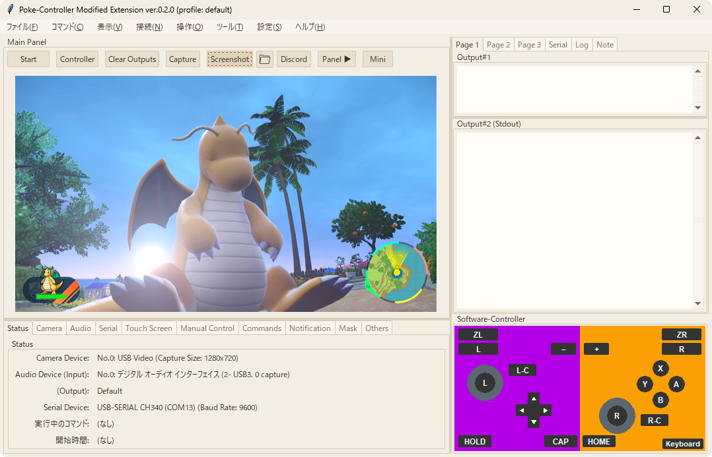

# Poke-Controller Modified Extension

[moi_poke](https://github.com/Moi-poke)氏が開発した[Poke-Controller Modified](https://github.com/Moi-poke/Poke-Controller-Modified)をベースに、機能を追加したゲーム機自動化支援ソフトウェアです。

- キャプチャーボードの映像を見ながら、PCからマイコン経由でゲーム機を操作します。操作は、Pythonのスクリプト(コマンド)で自動化できます。
- Switch / 3DS / DS / GameCube に対応しています。
- [Poke-Controller Modified](https://github.com/Moi-poke/Poke-Controller-Modified)との後方互換性の保持を必須として開発しています。Modified版で動作するスクリプトは、そのまま動作する(はず)です。



Poke-Controllerそのものの概要は、[KawaSwitch](https://github.com/KawaSwitch)氏の[Poke-Controller](https://github.com/KawaSwitch/Poke-Controller)と、[moi_poke](https://github.com/Moi-poke)氏の[Poke-Controller Modified](https://github.com/Moi-poke/Poke-Controller-Modified)を参照してください。


## 主な機能

- 画面
  - 出力画面を2つ表示(Output#1 / Output#2。常に表示しておきたい情報と、ログを分けられます)
  - 設定をタブにまとめた画面、コマンドの実行に必要な部品だけを並べたミニ画面
  - 今つながっている機器と実行中のコマンドを、まとめて表示(Statusタブ)
  - 送ったシリアルのデータ(Serialタブ)、ログ(Logタブ)、メモ(Noteタブ)の表示と、出力の中の文字の検索
  - パネルの位置・大きさの変更、テーマ(配色)の変更と作成
- スクリプト(コマンド)の実行
  - 名前での検索、タグでの絞り込み、名前・更新日時・使用頻度での並び替え、実行履歴
  - ショートカットへの割り当て
  - 一時停止(止まった位置と変数を表示)
  - コマンドの連続実行(実行リスト)、時刻・タイマーでの開始と停止の予約
  - PCがスリープから戻ったとき・機器への送信に続けて失敗したときの自動停止
- 手動での操作
  - キーボード、PCに接続したコントローラー、画面上のコントローラー(Software-Controller)
  - 操作の記録と、スクリプトとしての出力
  - Switchのキーボード画面への文字の入力(Keyboardウィンドウ)
  - 押したままになった入力を、まとめて離す(すべての入力を離す)
- カメラと音声
  - 取り込みサイズの選択、他のアプリケーションのウィンドウの取り込み(Windowsのみ)
  - キャプチャーボードの音声の再生(任意)
  - 同じ名前のキャプチャーデバイスを複数つないだ場合の区別
  - 目隠し(Mask): プレビューや保存する画像の一部を隠す(SNSにおける投稿や配信を想定した見せたくない情報を隠すための機能)
- 対応する機材
  - 送信するデータの形式を選択(Poke-Controller向け / NX Macro Controllerの形式 / [Qingpi](https://qiita.com/u1f992/items/09617ae326288a0df703)向け / 3DS Controller向け / FTDI直結のDS基板向け(任意))
  - 画面上でのタッチスクリーンの操作([Qingpi](https://qiita.com/u1f992/items/09617ae326288a0df703) / 3DS Controller)
- スクリプトの作成に役立つ機能
  - 画像認識の探索範囲・認識結果・類似度の表示
  - プレビュー上で選んだ範囲の保存(テンプレート画像の作成)、座標と色の表示
  - 入力内容を保持できるダイアログ、Switchへのキーボード入力
  - スクリプトのひな形の作成(新しい自動化スクリプトをつくる)、ファイルを開かないタグの編集
  - 画像認識・ダイアログ・MQTT・Socket通信などの関数の追加
- 通知
  - Discord(Webhook。通知先を複数登録可能)、Windowsの通知
  - コマンドの開始・終了時の通知
- 並列起動
  - プロファイルごとに設定を保持し、複数のウィンドウを同時に起動
  - 複数のウィンドウの状態・出力・映像を、1つの画面でまとめて表示(補助ツール「モニター」)
- スクリプトの作者への問い合わせの支援
  - 環境の診断(バージョン、必要なライブラリ、シリアル、カメラなどを調べて一覧で表示)、問い合わせ用の文章の作成

細かい変更点は、[更新履歴](changelog.txt)を参照してください。


## 動作環境

- OS
  - Windows 10 / 11
  - Mac / Linuxは、利用者の報告をもとに一部の対応を行っていますが、開発者の手元では動作を確認していません。IssueおよびPRには対応します。
- Python
  - 3.12以上(開発は3.12.2で行っています。従来の3.7はサポートが終了しているため、対象外とします。)
- 機材
  - 映像を取り込むキャプチャーボードと、ゲーム機を操作するマイコン(または自動化基板)が必要です。


## 導入と起動

### uv を使う方法(おすすめ。Pythonのインストールは不要です)

1. このリポジトリをダウンロードします。次のどれかで取得できます。
   - [PokeConExtension_Install.bat](https://github.com/futo030/Poke-Controller-Modified-Extension/releases/latest/download/PokeConExtension_Install.bat) をダウンロードして実行する(インストール先を尋ねた後、最新の版を取得して展開します。git は不要です)
   - [Releases](https://github.com/futo030/Poke-Controller-Modified-Extension/releases) から、ソースコードの ZIP をダウンロードして展開する
   - `git clone` する
2. `PokeConExtension.bat` を実行します。
   - 初回は、[uv](https://docs.astral.sh/uv/)(Python本体と、Pythonのライブラリを、まとめて用意して管理する道具。Astral社が公開している、無料のオープンソースのソフトウェアです)が、Python 3.13 と必要なライブラリを、リポジトリのフォルダの中(`.venv`)に用意します。数分かかります。
   - uv が入っていない場合は、確認のうえ、公式サイトからインストールします(pip でインストールした uv は使いません)。
   - PCに入っているPythonは使いません(変更もしません)。
   - プロファイルを選ぶ画面が表示されます。初めての場合は default を選びます。`PokeConExtension.bat --profile 名前` で、プロファイルを指定できます。
3. Cameraタブでキャプチャーボードを、Serialタブでマイコンのポートと Data Format を選びます。

- 自作のスクリプトで使うライブラリを足す場合は、`PokeConExtension_AddLibrary.bat` を実行して、ライブラリの名前を入力します(`pip install` では、この環境には入りません)。
- 今入っているライブラリと、その版は、`PokeConExtension_ListLibraries.bat` で確かめられます。足したライブラリを外すときは、`PokeConExtension_RemoveLibrary.bat` を実行します。
- 補助ツール(モニター)は、`PokeConExtension_Monitor.bat` で起動します。
- Web ブラウザ版の画面に必要なライブラリも、初めから入ります(`PokeConExtension.bat --ui web`)。

### 以前からの方法(pip を使う方法。ver.0.2.x まで)

ver.0.3.0 以降は、uv を使う方法だけになります。以前からの方法で使っている場合は、起動時に、uv の環境へ移行するかを確認する画面が表示されます。
移行しても、今までと同じ bat から起動できます(PCに入っているPythonと、そこに入っているライブラリは、そのまま残ります)。

1. Python 3.12以上をインストールします。
2. このリポジトリをダウンロードします(`git clone`、または Code > Download ZIP)。
   - 更新の確認と更新は、起動時に行われます(`git clone` で取得した場合は `git pull`、ZIP で取得した場合は Release の ZIP で更新します)。
3. リポジトリのフォルダで、必要なライブラリをインストールします。

```
pip install -r requirements.txt
```

4. `ExecutePokeConModified-Extension.bat` を実行します。
   - プロファイルを選ぶ画面が表示されます。初めての場合は default を選びます。
   - コマンドラインから起動する場合は、SerialControllerフォルダで `python Window.py` を実行します(`--profile 名前` でプロファイルを指定できます)。
5. Cameraタブでキャプチャーボードを、Serialタブでマイコンのポートと Data Format を選びます。
   - つながっている機器は、いちばん左のStatusタブでまとめて確かめられます。

初めて起動したときに、機能紹介が表示されます。詳しい使い方は、メニューの ヘルプ > Instruction Manual を参照してください。


## 任意の機能

次の機能は、使う場合のみ、追加のライブラリが必要です。

### FTDI直結のDS基板を使う場合

FT232HなどのFTDIチップのGPIOに、DSのボタンを直結した基板を使う場合のみ、追加で `ftd2xx` が必要です。
(使わない場合はインストール不要です。)

```
pip install ftd2xx
```

起動時に `--ds_ft` を付けた場合のみ、下記のData Formatが表示されます(SerialControllerフォルダで実行します)。

```
python Window.py --ds_ft
```

- Serialタブの Data Format に `DS FT (Rev3)` / `DS FT (Rev2)` / `DS FT (Rev1)` が追加されます。基板の配線に合うものを選んでください。
- デバイスは、これまでと同じくCOMポートで選びます(FTDIのドライバーで仮想COMポートとして見えている必要があります)。
- 対応する入力は A / B / X / Y / L / R / START / SELECT / POWER と十字キーです。スティック、タッチ、HOME等は送信されません。
- POWERは画面上のコントローラーには無く、スクリプトから `Button.POWER` を指定した場合のみ送信されます。
- このData Formatでは、Mcuコマンドとシリアルコマンドの直接送信は行いません。

### キャプチャーボードの音声を使う場合

キャプチャーボードの音声を、Poke Controllerから鳴らせます。必要な `sounddevice` は、`requirements.txt` に含まれています。
(以前の版から更新した場合は、`pip install -r requirements.txt` をもう一度実行してください。インストールしていなければ、Audioタブは表示されません。)

- Audioタブで `Use Audio` をオンにし、`Input` でキャプチャーボードの音声入力を選びます。
- `Playback` をオンにすると、再生デバイスから音が鳴ります。
- `Level` に取り込んでいる音量が表示されます。`No signal` と表示される場合は、デバイスから音声が届いていません。

### Webブラウザ版の画面を使う場合(試作)

これまでのウィンドウの代わりに、Webブラウザで画面を表示できます。使う場合のみ、追加のライブラリが必要です。
(使わない場合はインストール不要です。)

```
pip install -r requirements-web.txt
```

- `ExecutePokeConModified-Extension_web.bat` を実行するか、SerialControllerフォルダで次のように起動します。

```
python Window.py --ui web
python Window.py --ui web --profile 名前
```

- 起動すると、既定のブラウザで画面が開きます。開かない場合は、コンソールに表示されるアドレス(`http://127.0.0.1:8765/` など)を開いてください。
- 画面を開けるのは、Poke Controllerを動かしているPCのブラウザだけです。
- ポート番号は 8765 から順に、空いている番号を使います(複数のプロファイルを同時に起動できます)。`--port` で指定することもできます。
- 設定(プロファイル)は、これまでのウィンドウの画面と共通です。画面の配置は、ブラウザに保存されます。
- 使い方は、Web版の画面右上の ヘルプ > Instruction Manual を参照してください。

## 使い方の文書

- アプリケーションの中に、次の文書があります(メニューの ヘルプ から開けます)。
  - Instruction Manual: 起動から、設定、コマンドの実行、スクリプトの書き方までの説明
  - 機能紹介: そのバージョンの新機能の紹介
- スクリプト(コマンド)を作る人向けの文書
  - [スクリプトの書き方](SerialController/assets/manual/scripting.md): 基本の形と、使える関数の説明(Instruction Manualの「スクリプト…」と同じ文章)
  - [コマンド作成ガイド](docs/command-guide.md): 関数の早見表、動きの確かめ方、Poke-Controller Modifiedから移すときの注意
- 文書の一覧は、[docs](docs/README.md)にあります。[Wiki](https://github.com/futo030/Poke-Controller-Modified-Extension/wiki)にも、導入の手順とよくある質問をまとめています。
- 3DSの自動化については、[こちら](https://draco-meteor.hatenablog.com/entry/20240514)の記事を参照してください。


## Poke-Controller Modifiedとの互換性と違い

- スクリプトは、Modified版のものをそのまま `SerialController/Commands/PythonCommands` に置いて使えます。
- 設定は、プロファイルごとに `SerialController/profiles/プロファイル名` に保存されます。
- 画面の構成が変わっています(設定のタブ化、出力画面の2画面化、Software-Controllerの埋め込みなど)。
- 対応するゲーム機と機材が増えています(3DS / DS / GameCube)。


## 更新履歴

[更新履歴(changelog.txt)](changelog.txt)


## 貢献

このプロジェクトは, [all-contributors](https://github.com/all-contributors/all-contributors)仕様に準拠しています. どんな貢献も歓迎します。

不具合の報告や要望は、[Issues](https://github.com/futo030/Poke-Controller-Modified-Extension/issues) からお願いします(報告用のひな形があります)。

修正の提案(Pull Request)の出し方、検査とテストの手順、コードの書き方は、[CONTRIBUTING.md](CONTRIBUTING.md)を参照してください。フォルダの構成は、[docs/ARCHITECTURE.md](docs/ARCHITECTURE.md)にあります。


## 謝辞

[Poke-Controller](https://github.com/KawaSwitch/Poke-Controller)の開発者である[KawaSwitch](https://github.com/KawaSwitch)氏、[Poke-Controller Modified](https://github.com/Moi-poke/Poke-Controller-Modified)の開発者である[moi_poke](https://github.com/Moi-poke)氏にそれぞれ感謝申し上げます。

<!-- ALL-CONTRIBUTORS-LIST:START - Do not remove or modify this section -->
<!-- prettier-ignore-start -->
<!-- markdownlint-disable -->
<table>
  <tr>
    <td align="center"><a href="https://github.com/KawaSwitch"><br /><sub><b>KawaSwitch</b></sub></a><br /><a href="https://github.com/KawaSwitch/Poke-Controller/commits?author=KawaSwitch" title="Code">💻</a> <a href="#maintenance-KawaSwitch" title="Maintenance">🚧</a> <a href="https://github.com/KawaSwitch/Poke-Controller/commits?author=KawaSwitch" title="Documentation">📖</a> <a href="#question-KawaSwitch" title="Answering Questions">💬</a></td>
    <td align="center"><a href="https://github.com/Moi-poke"><br /><sub><b>Moi-poke</b></sub></a><br /><a href="https://github.com/KawaSwitch/Poke-Controller/commits?author=Moi-poke" title="Code">💻</a> <a href="#question-Moi-poke" title="Answering Questions">💬</a></td>
  </tr>
</table>

<!-- markdownlint-enable -->
<!-- prettier-ignore-end -->
<!-- ALL-CONTRIBUTORS-LIST:END -->


## ライセンス

本プロジェクトはMITライセンスです。
詳細は [Github - LICENSE](https://github.com/futo030/Poke-Controller-Modified-Extension/blob/master/LICENSE) を参照ください。
※今後変更の可能性があります。

このツールを組み込んで配布する場合は、LICENSE ファイル(著作権の表示と、許諾の文章)を、配布物に含めてください。クレジットの記載だけでは、ライセンスの条件を満たしません。

また, 本プロジェクトではLGPLライセンスのDirectShowLib-2005.dllを同梱し使用しています。
[About DirectShowLib](http://directshownet.sourceforge.net/)  
