# ver.0.2.0の新機能紹介

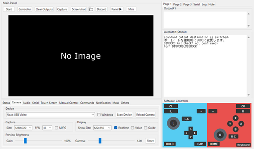

ver.0.2.0 で追加・変更した機能を、次のページから紹介します。
- 「次へ >」「< 前へ」(または 左右の矢印キー)でページを送ります。

【重要】このツール専用の環境(uv と .venv)へ移行します。ver.0.3.x 以降は、完全に uv に移行します(以前からの Python と pip の環境では、起動できなくなります)。
- uv とは: Python 本体と、Python のライブラリを、まとめて用意して管理する道具です(Astral 社が公開している、無料のオープンソースのソフトウェア)。これまで自分で行っていた「Python のインストール」と「pip でのライブラリのインストール」を、uv が代わりに行います。
- 目的: Python と必要なライブラリの版を、全員で同じにそろえ、Python のバージョンを上げやすくするためです(今回、Python 3.13 になります)。PC に Python を入れていなくても、使えるようになります。
- 移行: 以前からの方法で起動すると、移行するかを確認する画面が出ます。「はい」を選ぶと、uv という道具が、ツールのフォルダの中に専用の環境(.venv)を作ります。今の Python と、そこに入っているライブラリは、そのまま残ります。
- 足していたライブラリ: 自作のスクリプト用に足していたライブラリは、移行のときに、一覧から選んで引き継げます。
- ライブラリの追加: 移行した後は、pip install では入りません。PokeConExtension_AddLibrary.bat を実行して、ライブラリの名前を入力します。
- 起動: PokeConExtension.bat で起動します。今までの bat でも起動できます(移行した後は、どちらも専用の環境で動きます)。
- ver.0.2.x の間は、以前からの環境でも起動できます。早めの移行をおすすめします。
- 詳しくは、ヘルプ > Instruction Manual の「起動と終了」にある「環境(uv と .venv)」を見てください。
- この画面は、メニューバーの ヘルプ > 機能紹介 からいつでも開けます。
- 「今後は表示しない」にチェックを入れて OK を押すと、起動時には表示されなくなります。紹介の内容が更新されたときは、もう一度表示されます。

# タブの構成

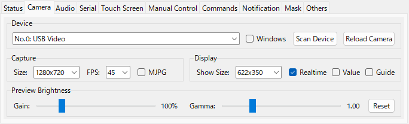

画面下のタブを整理し、各タブの中の配置を見直しました。
- タブは Status / Camera / Audio / Serial / Touch Screen / Manual Control / Commands / Notification / Mask / Others の10個です。
- Status / Audio / Touch Screen / Mask は新しいタブです。
- Manual Control タブは、Software と Hardware を左右に並べ、Record ボタンを置きました。

# Status

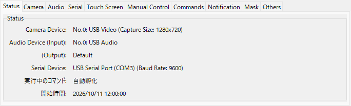

いちばん左のタブです。今つながっている機器と、実行中のコマンドを、1 か所で確かめられます(表示するだけで、設定は変えません)。
- Camera Device: 開いているカメラの名前と、Capture Size
- Audio Device: 取り込んでいるデバイス(Input)と、再生しているデバイス(Output)
- Serial Device: 接続している機器の名前(COM ポート)と、Baud Rate
- 実行中のコマンド / 開始時間: コマンドの名前と、開始した時刻
- 使っていないものは「(開いていません)」「(接続していません)」「(なし)」などと表示します。

# Camera

- Capture Size に 720x480 と 1920x1080 を追加しました。Show Size の候補は Capture Size に合わせて切り替わります。
- MJPG にチェックを入れると、圧縮形式で取り込みます。1280x720 以上で fps が出ないときに試してください。
- カメラを開いていないときの「No Image」は、プレビューの大きさに合わせて表示します。
- プレビューは、Main Panel に収まる最大の大きさで表示します。ウィンドウの枠や仕切り線をドラッグすると、大きさが変わります(高さの下限は 160)。
- Show Size で大きさを選ぶ(または幅を入力して Enter)と、プレビューがその大きさになるように、ウィンドウの大きさが変わります。
- Preview Brightness で、プレビューの明るさを変えられるようにしました。Gain は色の値を何倍かにし、Gamma は暗い部分を明るくします(Reset で元に戻します)。Software-Controller のタッチスクリーンの表示も、同じ明るさになります。
- 明るさを変えるのは表示だけです。Capture の画像、Screenshot、コマンドの画像認識、Ctrl+クリックで表示する色は、元の明るさのままです。

# Audio

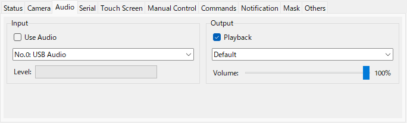

キャプチャーボードなどの音声を取り込み、PCで再生できます。(sounddevice というライブラリを使います。PokeConExtension.bat で用意される環境には、初めから入っています。入っていない場合、このタブは表示されません)
- Input: 取り込むデバイス。カメラと同じ機器には、カメラと同じ番号(No.)が付きます。
- Output: 再生するデバイスと音量。Playback を外すと、取り込みだけを行います。

# Serial

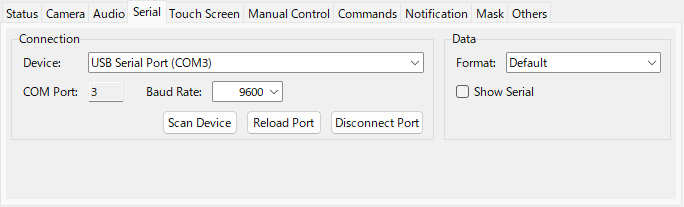

- Connection(接続)と Data(送るデータ)に分けました。
- Data の Format に、NX(NX Macro Controller の形式。CH552-SERIAL などが対応)を追加しました。右スティックと、Switch へのキーボード入力にも対応しています。
- Data の Format に、FTDI(FT232H)で直結する DS 用の基板の形式(DS FT (Rev1)〜(Rev3))を追加しました。ftd2xx をインストールし、起動時に --ds_ft を付けた場合のみ、一覧に表示されます。
- 機器へ送ったデータは、右側のパネルの Serial タブで、いつでも確かめられます(「Output のタブと検索」のページを参照)。

# Touch Screen

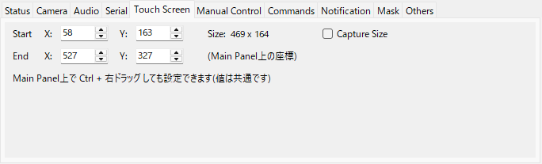

Qingpi / 3DS 用の、Main Panel 上のタッチスクリーンの範囲を数値で設定できます。
- Main Panel 上で Ctrl + 右ドラッグ して設定する範囲と共通です。
- 範囲の大きさ(Size)も表示します。

# Manual Control

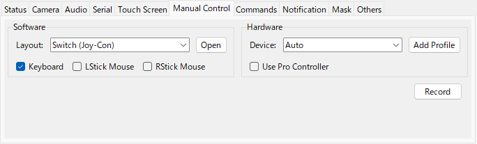

Software と Hardware を左右に並べ、項目を整理しました。
- Software: 画面上のコントローラーの Layout を選びます。Open で Controller Simulator のウィンドウを開きます。Keyboard / LStick Mouse / RStick Mouse は、キーボードとマウスでの操作です。
- Hardware: PCに接続したコントローラーで操作します。複数の種類のコントローラーに対応し、Device で使うコントローラーを選べます。Add Profile で、ボタンの割り当てを画面の案内に沿って作れます。
- Record: 「Record Pro Controller」のチェックボックスを、Record ボタンに変えました。接続したコントローラーに加え、キーボード・画面上のコントローラー・マウス・タッチの操作も記録し、終了時に自動化スクリプトとして出力します。記録中は文字が赤くなります。

# Software-Controller のレイアウト

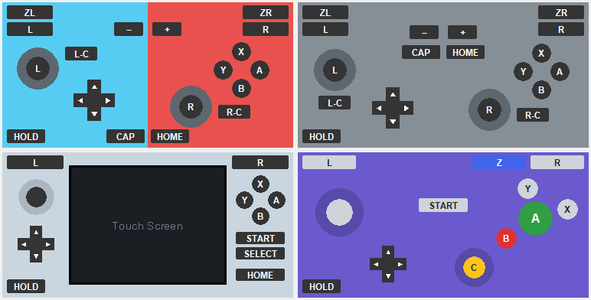

メイン画面右下の Software-Controller を、ゲーム機に合わせたレイアウトにできます。
- Switch (Joy-Con) / Switch (Pro Controller) / 3DS / DS / GameCube から選べます。3DS と DS は、タッチスクリーンあり・なしを選べます。
- HOLD を押してからボタンを押す、またはボタンを右クリックすると、押しっぱなしにできます(黄色で表示)。もう一度押すと離します。
- タッチスクリーンありのレイアウトでは、タッチスクリーンの範囲のカメラ画像が表示され、クリックでタッチできます。

# Controller Simulator

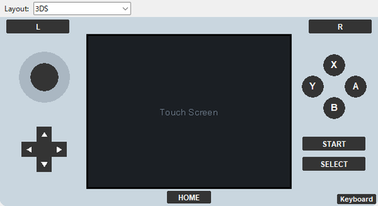

Main Panel の「Controller」(または Manual Control の Open)で開く、大きいコントローラーです。
- ウィンドウ上部の Layout で、Switch (Joy-Con) / Switch (Pro Controller) / 3DS / DS / GameCube を切り替えられます。
- 3DS / DS のタッチスクリーンは、実際の画面と同じ大きさで操作できます。

# Commands

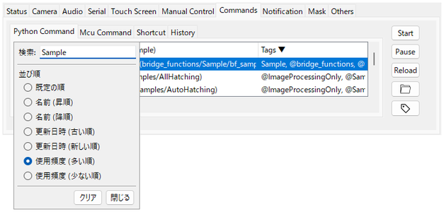

- Command の見出しをクリックすると、名前・更新日時・使用頻度(開始した回数)での並び替えと、名前の検索ができます。
- Tags の見出しでは、検索欄に入力した文字を含むタグに、自動でチェックが入ります。
- History は、Last Run の見出しで新しい順・古い順を切り替えられます。右クリックの Delete / Delete (ALL) で履歴を消せます。
- コマンドを右クリックすると、そのコマンドのファイルを開けます(Open file / Open with... / Open folder / Copy path)。Shortcut のボタンでも同じです。
- ボタンは、押す順に Start / Pause / Reload / フォルダを開く の順に並べました。

# コマンドの管理

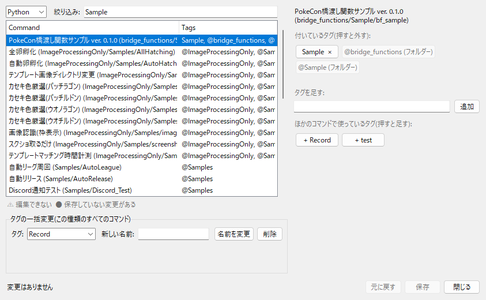

コマンドを整理したり、続けて実行したりする機能を追加しました。
- タグを編集(コマンド > タグを編集...、または Commands タブのタグの絵のボタン): ファイルを開かずに、タグを足したり外したりできます。タグの名前の一括変更・削除もできます。
- 新しい自動化スクリプトをつくる(ツール): スクリプト名や格納場所を入力すると、そのまま実行できるスクリプトのひな形を作って、エディタで開きます。
- 実行リスト(コマンド > 実行リスト (連続実行)...): コマンドを並べて、順に実行します。行ごとに、回数と制限時間を決められます。
- 開始と停止の予約(コマンド > 開始と停止の予約...): 時刻、または今からの分で、コマンドの開始と停止を予約できます。
- 使い方は、Instruction Manual の「コマンドを実行する」を見てください。

# Pause(一時停止)

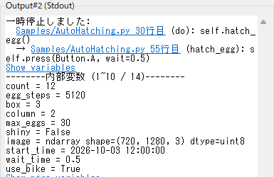

コマンドを一時停止したときに、止まった位置と変数を確認できるようにしました。
- 一時停止すると、止まった位置(ファイル・行・関数・その行のコード)を、呼び出しの順に表示します。ファイルの位置をクリックすると、そのファイルを開きます。
- 「Show variables」を押すと、スクリプトの変数を10個ずつ表示します(「Show more variables」で続きを表示)。一時停止のたびに変数をすべて表示することはなくなりました。
- press はボタンを離してから、画像認識は判定する前に一時停止するようにしました。押したまま止まったり、再開後に止まる前の画面での判定結果が返ったりしません。
- Mcu コマンドの実行中は、Pause を押せないようにしました(マイコン側で動いているため)。

# キーボード入力(コマンド)

コマンドから、Switch のキーボード画面に文字やキーを打てるようにしました。(キーボード入力に対応したファームウェアを書き込んだマイコンが必要です)
- TypeString("neko") で半角の文字列を打ち、TypeKey(KEY.ENTER) などでキーを押します。押したままにする PressKey / ReleaseKey もあります。
- 送れるのは半角の文字だけです。かな・カナは、Switch 側をローマ字入力にしてローマ字を送ります。
- 変換(KEY.SPACE / KEY.JP_HENKAN)、候補の選択(矢印キー)、半角/全角(KEY.JP_HANZEN)、ひらがな/カタカナ(KEY.JP_HIRAGANA)も送れます。
- 注意: CH552-SERIAL の場合は、ファームウェアは v2.4 以上を使用してください。Arduino Leonardo の場合は、Poke-ControllerForLeonardo の v04 以降が必要です。
- Serial タブの Data の Format が Default または NX の場合に使えます。
- 使い方は、Instruction Manual の「スクリプト: キーボード入力」と、サンプル(Samples/Keyboard_sample.py)を見てください。

# Keyboard ウィンドウ

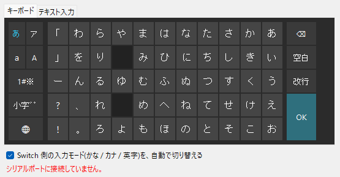

Switch のキーボード画面に、手動で文字を打つためのウィンドウです。
- Software-Controller と Controller Simulator の右下の Keyboard ボタン、または 操作 > Keyboard を開く で開きます。
- キーボード タブでは、画面上のキーを押して、1 文字ずつ送ります。かな・カナ・英字のページを切り替えられます。
- テキスト入力 タブでは、文字を入力して、まとめて送ります。
- 使い方は、Instruction Manual の「最初の設定」の「Switch のキーボード画面に文字を打つ」を見てください。

# Mask

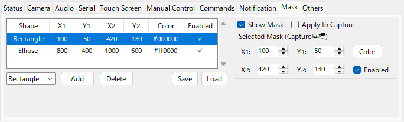

プレビューの一部を、長方形や楕円で目隠しできます。SNSにおける投稿や配信を想定した、見せたくない情報を隠すための機能です。
- 形を選んで Add を押し、Main Panel 上をドラッグして追加します。位置・色・有効/無効は、右側で変えられます。
- Apply to Capture にチェックを入れると、Capture で保存する画像にも目隠しを描き込みます。
- Save / Load で、目隠しの一覧を名前を付けて書き出し・読み込みできます。

# Capture と Screenshot

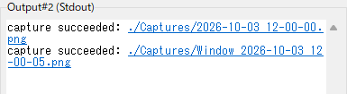

- Main Panel に Screenshot ボタンを追加しました。アプリケーションのウィンドウ全体を、Captures フォルダに保存します。
- 画像を保存したときに Output に出るパスは、リンクになります。クリックで画像を開き、右クリックで「Open with...(アプリを選ぶ)」「Open folder」「Copy path」を選べます。

# Output のタブと検索

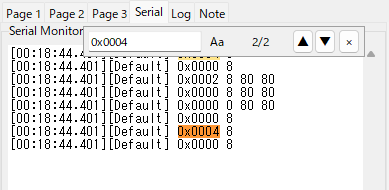

右側のパネルの Output に、タブと検索を追加しました。
- Serial タブ: 機器へ送ったデータを、[時刻][Data の Format の名前] 値 の形で表示します(Show Serial のチェックに関係なく、いつも表示します)。
- Log タブ: コンソール(黒い画面)に出ているログと同じ内容を、レベルごとに色を付けて表示します。上の Level で、表示するレベルを絞り込めます。
- Note タブ: 自由に書き込めるメモです。プロファイルごとに、自動で保存します。
- 文字の検索: 出力画面をクリックしてから Ctrl+F を押す(または右クリックの Find...)と、検索の欄が出ます。Enter / Shift+Enter で前後に移動し、「Aa」で大文字と小文字の区別を切り替えます。

# 右側のパネルの位置

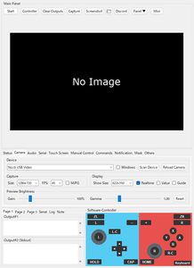

Main Panel の Panel ボタンで、右側の Output と Software-Controller の位置を変えられます。
- 押すたびに、右(Panel ▶)→ 下(Panel ▼)→ 表示しない(Panel ✕)の順に切り替わります。
- 下に置くと、Output と Software-Controller をタブの下に横に並べます。ウィンドウの幅が狭くなるので、複数のウィンドウを並べやすくなります。
- 表示しない間も、Output への出力は続いています。
- ミニ画面でも同じように切り替えられます。通常の画面とミニ画面を切り替えても、位置はそのまま引き継がれます。

# 仕切り線

画面の領域の間に、マウスで動かせる仕切り線を入れました。
- 左側(Main Panel と左下のタブ)と右側のパネルの間で、左右の幅の比率を変えられます。
- Main Panel と左下のタブの間で、上下の高さの比率を変えられます。
- ウィンドウの大きさを変えても、比率は変わりません。プレビューは Main Panel に収まる最大の大きさで表示します。
- 比率は、パネルの位置(右 / 下 / 表示しない)ごとに保存されます。ミニ画面にも仕切り線があります。
- Output#1 と Output#2 の間の仕切り線をドラッグすると、2つの高さの比率が変わります(Others タブの Size と同じ設定です)。

# ミニ画面

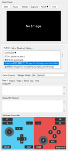

Main Panel の「Mini」で、コマンドの選択と実行に必要な部品だけを縦に並べた、幅の狭い画面に切り替わります。「Full」で元に戻ります。
- 切り替えると、プレビューは高さ 180 になり、ウィンドウは中身に合わせた大きさになります。ウィンドウの枠や仕切り線をドラッグすると、プレビューの大きさも変わります(高さの下限は 180)。
- 上のボタンは Start / Pause / Reload / Capture / Panel / Full になります。
- Panel ボタンで、Widget Mode・Clear Outputs・Output・Software-Controller の位置を、下 → 表示しない → 右 の順に切り替えます。通常の画面とミニ画面を切り替えても、位置はそのまま引き継がれます。
- ミニ画面の Widget Mode は、通常の画面とは別に保存されます。

# コントローラー設定(本体の色)

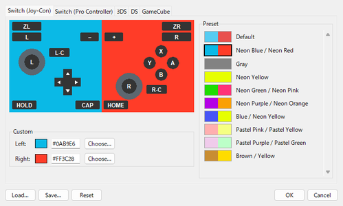

設定 > コントローラーの色... で、Software-Controller と Controller Simulator の本体の色を変えられます。
- コントローラーの種類ごとに設定します。Preset から選ぶか、Custom で色を指定します。
- Save... で書き出した自分の色は、Preset の一覧にも並びます。Load... でファイルから読み込めます。

# キーコンフィグ

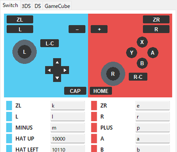

設定 > キーコンフィグ... で、キーボードのキーとボタンの対応を設定します。
- Switch / 3DS / DS / GameCube ごとに設定できます。どの設定を使うかは、Manual Control の Layout で決まります。
- 入力欄を選んでキーを押し、OK で保存します。同じキーを複数のボタンに割り当てている場合は、警告が出て保存されません。
- 設定した内容は、終了後も保存されるようになりました。

# テーマ(配色)

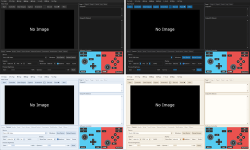

表示 > テーマ で、画面の配色を変えられます。
- デフォルト (Light)(今までの見た目)のほか、ダーク3種類(A〜C)と、明るい配色5種類(D〜H)から選べます。
- 選ぶとすぐ、開いているすべてのウィンドウに反映します。テーマはプロファイルごとに保存されます。
- デフォルト以外のテーマでは、メニューバーもテーマの色で表示します。Windows 11 では、タイトルバーの色もテーマに合わせます。
- 表示 > テーマ > テーマを作る / 編集する... で、自分の配色を作れます。選んだ色を本体の画面で試しながら、色を決められます。
- プレビューの映像と、Software-Controller の色(コントローラー設定)は、テーマを変えても変わりません。

# プロファイル

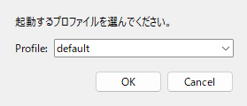

- --profile を付けずに起動すると、プロファイルを選ぶ画面が出ます(プロファイルが1つだけの場合は出ません)。
- --auto を付けて起動すると、起動されていないプロファイルを自動で選びます。優先する順番は profiles/priority.txt に書きます。すべて起動中の場合は、default で起動するか、新しいプロファイルを作るかを選べます。
- 同じプロファイルで2つ目以降に起動したウィンドウでは、設定を保存しません(タイトルに表示されます)。
- プロファイルの名前に使えるのは、アルファベット・数字・「-」・「_」です。
- プロファイルを追加すると、そのプロファイルで起動する bat ができます。uv の環境(.venv)があるときは、bat の形(uv 向け / 従来)を選べます。

# 補助ツール(モニター)と Web ブラウザ版

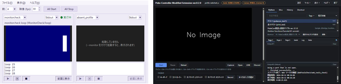

- モニター: 複数起動したウィンドウの、実行中のコマンド・Output・カメラの映像を、1 つの画面でまとめて見る補助ツールです。見たいウィンドウを --monitor を付けて起動し(ExecutePokeConModified-Extension_with_monitor.bat)、ExecutePokeConMonitor.bat で補助ツールを起動します。
- Web ブラウザ版: --ui web を付けて起動すると(PokeConExtension.bat --ui web、または ExecutePokeConModified-Extension_web.bat)、画面を Web ブラウザで表示できます。設定とスクリプトは、ウィンドウの画面と共通です。
- どちらも、使い方は Instruction Manual の「最初の設定」「起動と終了」にあります。

# 動作の改善

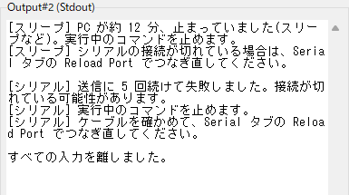

- 長い wait の途中でも、Stop を押すと、待ち終わる前に止まるようになりました。
- PC がスリープから戻ったときと、機器への送信に続けて失敗したときは、実行中のコマンドを自動で止めて、理由を Output に表示します。
- 操作 > すべての入力を離す で、押したまま・倒したままになっている入力を、すべて離せます。
- 入力欄に文字を打っている間、キーを受け取って動く部品(タブの並び、コンボボックス、コマンドの一覧、つまみなど)を選んでいる間、メニューを操作している間は、キーボードでの操作をゲーム機に送りません。
- ログのファイルの名前に、プロファイルの名前が入るようになりました(log_プロファイル名_日時.log)。
- 起動した直後に、ウィンドウの大きさや部品の位置が動いて見えることがなくなりました。
- 更新の確認を、GitHub の Release を基準にしました。git を入れていなくても(ZIP で取得した場合も)、起動時に更新できます。手元で変更したファイルは、old フォルダに退避されます。
- シリアルポートを開けなかったときに、試すこと(機器の抜き差しと、Scan Device・Reload Port)を、Output に表示します。

# そのほかの変更

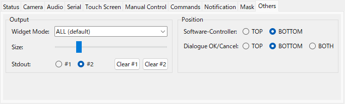

- Others タブを Output(Widget Mode・大きさ・標準出力の出力先)と Position にまとめました。
- Notification タブは、Windows / Line / Discord を横1列に並べました。
- Discord の通知に付ける画像を、「画面」(キャプチャ画面の今の画像)と「ウィンドウ全体」から選べます(Notification タブの Discord Notification)。Test・Start・End と、Main Panel の Discord ボタンに効きます。Start / End の通知にも、画像が付くようになりました。
- ツール > Discord にウィンドウ全体を送信 で、このツールのウィンドウ全体の画像を、Discord に送れます。
- ヘルプ > Instruction Manual に、「ハードウェアの設定」と「Discord 通知の設定」のページを追加しました。マニュアルの中の URL は、クリックするとブラウザで開きます。
- ヘルプ > 環境の診断 で、バージョンや、必要なものがそろっているか、uv の環境で動いているかを、まとめて確かめられます(「コピー」で、全体をコピーできます)。
- ヘルプ > Instruction Manual で、このツールのマニュアル(スクリプトで使えるコマンドの説明を含む)を見られます。
- メニューバーを、ファイル / コマンド / 表示 / 接続 / 操作 / ツール / 設定 / ヘルプ の8つに組み替えました。Alt キーを押しながら ( ) の中のキーを押すと、キーボードで開けます(例: Alt + F)。
- 十字キーの左右の矢印の形を整えました。
- 終了時に、接続したコントローラーの処理が止まらないことがある問題を修正しました。
- キーコンフィグの画面を開くと、メイン画面の背景が白くなる問題を修正しました。
