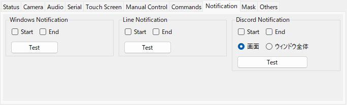

# はじめに

Poke-Controller Modified Extension は、PCからマイコンなどを通してゲーム機のコントローラー入力を送り、操作を自動化するためのツールです。

## できること
- キャプチャーボードの映像を見ながら、キーボード・マウス・PCに接続したコントローラーでゲーム機を操作する
- Python で書いた自動化スクリプト(コマンド)を実行する
- 映像の画像認識を使ったスクリプトを実行する
- 手動操作を記録して、スクリプトとして出力する

## 必要なもの
- ゲーム機に入力を送る機器(マイコン、3DS用の基板など)と、PCとつなぐシリアル変換
- 画像認識や映像の確認をする場合は、キャプチャーボード

## このマニュアルの見方
- 左の一覧から項目を選ぶと、右に説明が表示されます。
- 説明の文字は選択してコピーできます(Ctrl+C、または右クリックの Copy)。
- このマニュアルは、メニューバーの ヘルプ > Instruction Manual で開きます。
- 新しく追加された機能の紹介は、ヘルプ > 機能紹介 で見られます。

# 起動と終了

## 環境(uv と .venv)
- uv は、Python 本体と、Python のライブラリを、まとめて用意して管理する道具です(Astral 社が公開している、無料のオープンソースのソフトウェア。https://docs.astral.sh/uv/ )。これまで自分で行っていた「Python のインストール」と「pip でのライブラリのインストール」を、uv が代わりに行います。
- uv 本体と、uv が取得した Python は、利用者のフォルダ(C:/Users/名前 の下)に置かれます。どちらも、管理者の権限は要りません。
- このツールは、ツールのフォルダの中の .venv という専用の環境(Python と、必要なライブラリ)で動きます。uv という道具が用意します。PC に入っている Python は、使いません(変更もしません)。
- 自作のスクリプトで使うライブラリを足すときは、PokeConExtension_AddLibrary.bat を実行して、名前を入力します(pip install では、この環境には入りません)。足したライブラリの名前は、ツールのフォルダの requirements-user.txt に残ります。
- 今入っているライブラリと、その版は、PokeConExtension_ListLibraries.bat で確かめられます(本体が使うもの、自分で足したもの、そのほかに分けて表示します)。
- 名前を間違えたなどで、入れられなかったライブラリは、requirements-user.txt には残りません。
- 足したライブラリを外すときは、PokeConExtension_RemoveLibrary.bat を実行して、名前を入力します(requirements-user.txt と、.venv の両方から外します)。
- 以前からの環境(PC の Python と pip)で使っている場合は、起動時に、移行するかを確認する画面が出ます。足していたライブラリは、一覧から選んで引き継げます。移行しても、今までの Python と、そこに入っているライブラリは、そのまま残ります。
- ver.0.3.0 以降は、この環境だけを対象にします。
- 今どちらの環境で動いているかは、ヘルプ > 環境の診断 の「環境」で確かめられます。
- 更新は、起動時に確かめます(GitHub の Release を基準にします)。git で取得したフォルダは git pull、それ以外は Release の ZIP で、変わったファイルだけを入れ替えます。手元で変更したファイルは、old フォルダに退避されます。

## 起動
- PokeConExtension.bat を実行します(PC に Python が入っていなくても動きます)。
- 初めて実行したときは、uv(Python と、必要なライブラリを用意する道具)が、Python と必要なライブラリを、ツールのフォルダの中(.venv)に用意します。数分かかります。uv が入っていない場合は、確認のうえ、公式サイトからインストールします。
- プロファイルを指定する場合は、PokeConExtension.bat --profile 名前 のように、後ろに付けます(下の python Window.py に付けるものと同じものが使えます)。
- 以前からの ExecutePokeConModified-Extension.bat でも起動できます。ツールのフォルダに .venv がある場合は、その中の Python で動きます。
- 直接起動する場合は、SerialController フォルダで次を実行します。
```
python Window.py
python Window.py --profile 名前
python Window.py --auto
```

## プロファイル

- プロファイルは、設定一式(カメラ・シリアル・キーの対応など)を名前を付けて分けておく仕組みです。profiles フォルダに、名前ごとのフォルダが作られます。
- --profile を付けずに起動すると、プロファイルを選ぶ画面が出ます(プロファイルが1つだけの場合は出ません)。
- --auto を付けると、起動されていないプロファイルを自動で選びます。優先する順番は profiles/priority.txt に、1行に1つずつ書きます。
- uv の環境(.venv)があるときにプロファイルを足すと、起動用の bat の形を選べます。「uv 向け」は PokeConExtension.bat を呼ぶ形(PC に Python が入っていなくても動きます)、「従来」は python で起動する形です。どちらで起動しても、.venv の Python で動きます。
- 新しいプロファイルは、ファイル > プロファイルを追加... で作れます。名前に使えるのは、アルファベット・数字・「-」・「_」です。
- 同じプロファイルで2つ目以降に起動したウィンドウでは、設定を保存しません。

## 終了
- ウィンドウの × を押し、確認で「はい」を選びます。このとき、設定がプロファイルに保存されます。

## Web ブラウザ版として起動する
- 画面を、ウィンドウの代わりに Web ブラウザで表示できます(Web 版)。SerialController フォルダで、--ui web を付けて起動します。
```
python Window.py --ui web
python Window.py --ui web --profile 名前
```
- PokeConExtension.bat --ui web でも起動できます。
- uv の環境(.venv)には、Web 版に必要なパッケージが初めから入っています。以前からの環境(PC の Python と pip)で使うときだけ、ツールのフォルダ(SerialController の1つ上)で、次を実行します。
```
pip install -r requirements-web.txt
```
- 起動すると、既定のブラウザで画面が開きます。開かない場合は、コンソールに表示されるアドレス(http://127.0.0.1:8765/ など)をブラウザで開きます。
- --profile を付けない場合は default を使います(選ぶ画面は出ません)。--auto も使えます。
- ポート番号は 8765 から順に、空いている番号が使われます。複数のプロファイルを同時に起動すると、2つ目は 8766 のようになります。--port で指定することもできます。
- 設定(プロファイル)は、この画面と Web 版で共通です。画面の配置は別々に保存されます。
- Web 版の使い方は、Web 版の画面右上の ヘルプ > Instruction Manual にあります。
- 終了は、Web 版の画面右上の「終了」ボタン、またはコンソールでの Ctrl+C で行います。

# 画面の構成


## Main Panel(左上)
- プレビュー: キャプチャーボードの映像を表示します。
- Start: 選んでいるコマンドを実行します。実行中は Stop になります。
- Controller: Controller Simulator(大きいコントローラー)のウィンドウを開きます。
- Clear Outputs: 右側の Output を消します。
- Capture: カメラの画像を Captures フォルダに保存します。
- Screenshot: アプリケーションのウィンドウ全体を Captures フォルダに保存します。
- フォルダの絵のボタン: Captures フォルダを開きます。
- Discord: 今の画像を Discord に送ります。送る画像(画面 / ウィンドウ全体)は、Notification タブの Discord Notification で選びます。
- Panel ▶ / Panel ▼ / Panel ✕: 右側のパネル(Output・Software-Controller)の位置を、押すたびに 右 → 下 → 表示しない の順に切り替えます。下に置くと、Output と Software-Controller をタブの下に横に並べます。
- Mini / Full: ミニ画面と通常の画面を切り替えます。

## タブ(左下)
- Status / Camera / Audio / Serial / Touch Screen / Manual Control / Commands / Notification / Mask / Others の10個です。
- Status タブは、今つながっている機器と、実行中のコマンドを表示するだけのタブです(下の「Status タブ」を参照)。
- それぞれの使い方は、このマニュアルの各項目を見てください。

## Status タブ

- いちばん左(Camera タブの左)のタブで、起動したときに表示されます。今つながっている機器と、実行中のコマンドを、1 か所で確かめられます。表示するだけで、設定は変えません(変えるときは、それぞれのタブを使います)。
- Camera Device: 開いているカメラの名前と、Capture Size(取り込みサイズ)。カメラを開いていないときは「(開いていません)」。
- Audio Device (Input) / (Output): 取り込んでいるデバイスと、再生しているデバイス。Use Audio にチェックを入れていないときは「(使用していません)」、Playback を外しているときの Output は「(再生しません)」。sounddevice が入っていないときは「(使用できません)」。
- Serial Device: 接続している機器の名前(COM ポートの番号を含む)と、Baud Rate。機器の名前に COM ポートの番号が入っていないときは、Baud Rate の前に番号も表示します。接続していないときは「(接続していません)」。
- 実行中のコマンド: コマンドの名前。実行していないときは「(なし)」。
- 開始時間: 実行中のコマンドを開始した時刻(年/月/日 時:分:秒)。実行していないときは「(なし)」。実行リストを実行している間は、実行リストの名前と、リストを開始した時刻です。
- このタブを表示している間、約 0.5 秒ごとに調べ直します。

## 仕切り線
- 左側(Main Panel と左下のタブ)と右側のパネルの間、Main Panel と左下のタブの間に、仕切り線があります。マウスでドラッグすると、領域の大きさの比率を変えられます。
- ウィンドウの大きさを変えても、仕切り線の位置の比率は変わりません。比率は、パネルの位置(右 / 下 / 表示しない)ごとに保存されます。
- ミニ画面にも仕切り線があります(Main Panel / コマンド / パネルの間)。ミニ画面に切り替えると、中身に合わせた大きさと仕切り線の位置になります。
- Output#1 と Output#2 の間にも仕切り線があります。ドラッグすると、2つの高さの比率が変わります(Others タブの Size と同じ設定です)。

## 右側のパネル
- Output#1 / Output#2: スクリプトやツールからの出力が表示されます。Page 1~3 を切り替えられます。パネルの高さに合わせて行数が変わります(Output#1 と #2 の比率は、間の仕切り線のドラッグか、Others タブの Size で変えられます)。
- Serial: Page 3 の後ろのタブです。機器へ送ったデータを(下のタブ領域の Serial タブの Show Serial のチェックに関係なく、いつも) [時刻][Data の Format の名前] 値 の形で表示します。右クリックのメニューの Clear で、表示を消せます。
- Log: Serial の後ろのタブです。コンソール(黒い画面)に出ているログと同じ内容を表示します。DEBUG は薄い色、WARNING は黄〜橙、ERROR は赤で表示します。上の Level で、表示するレベルを絞り込めます(選んだレベルより低い行を隠すだけで、消しません。選び直すと、また表示されます。選んだレベルは、プロファイルごとに保存します)。右クリックのメニューの Clear で、表示を消せます(log フォルダーのファイルは消えません)。表示は、このタブを開いている間だけ更新します。開いていない間のログは、新しいものから 10000 件まで覚えていて、開いたときに表示します。
- Note: Log の後ろのタブです。自由に書き込めるメモです(調べたこと、設定の値、次にやることなど)。書いた内容は、プロファイルごとに、自動で保存します(書き換えてから約 1 秒後と、アプリの終了時。保存先は profiles/プロファイル名/note.txt)。Ctrl+Z で元に戻せます。右クリックのメニューで、切り取り・コピー・貼り付け・検索ができます。入力している間は、キーボードでの手動操作を止めるので、打った文字はゲーム機に送られません。同じプロファイルで 2 つ目に起動したウィンドウでは、保存しません。
- 文字の検索: 出力画面(Page 1〜3、Serial、Log、Note)をクリックしてから Ctrl+F を押すか、右クリックの Find... を選ぶと、右上に検索の欄が出ます。入力した文字を含む所に色が付き、いちばん新しい(下の)一致が選ばれます。Enter か ▲ で前(上)へ、Shift+Enter か ▼ で次(下)へ動きます。Esc か × で閉じます。大文字と小文字は、初めは区別しません。検索の欄の「Aa」を押すと、区別する / しないを切り替えられます。対象は、表示しているタブの出力画面です(Page は Output#1 と #2 の両方)。文字を選んでから開くと、その文字を検索します。
- Software-Controller: 画面上のコントローラーです。クリックで操作できます。
- 画像を保存したときに出るパスはリンクになっていて、クリックで画像を開けます。

## ミニ画面

- コマンドの選択と実行に必要な部品だけを縦に並べた、幅の狭い画面です。
- 切り替えると、プレビューは高さ 180 になり、ウィンドウは中身に合わせた大きさになります。ウィンドウの枠や仕切り線をドラッグすると、プレビューの大きさも変わります(ミニ画面での高さの下限は 180)。通常の画面に戻すと、ミニ画面にする前の大きさに戻ります。
- Panel ボタンで、Output と Software-Controller の位置を、下(コマンドの下)→ 表示しない → 右 の順に切り替えます。通常の画面とミニ画面を切り替えても、位置はそのまま引き継がれます。

# ハードウェアの設定

ゲーム機に入力を送る機器(マイコン)は、使う前に、機器の側の設定が必要です。手順は、機器ごとに、次のページを参照してください(リンクをクリックすると、ブラウザで開きます)。
- Arduino Leonardo: https://pokecontroller.info/SetLeonardo
- CH552 Serial: https://blog.bzl-web.com/entry/2022/11/24/001148

機器の設定が済んだら、次の「最初の設定」で、このツールの側の設定(ポートと Data Format)を行います。

# 最初の設定

## 1. カメラ(Camera タブ)

- Device でキャプチャーボードを選び、Reload Camera を押します。
- Capture の Size は取り込む大きさ、FPS は取り込む速さです。Size を変えたときは Reload Camera で反映します。
- 1280x720 以上で映像がカクつく場合は、MJPG にチェックを入れてみてください。
- プレビューは、Main Panel の中に収まる最大の大きさで表示します(縦横比は取り込み画像と同じ)。ウィンドウの枠や仕切り線をドラッグすると、プレビューの大きさも変わります。プレビューの高さは 160 より小さくなりません。
- Display の Show Size は、今のプレビューの大きさです。候補から選ぶか、幅(例: 1000)を入力して Enter を押すと、プレビューがその大きさになるようにウィンドウの大きさが変わります(仕切り線の位置の比率はそのまま)。
- Realtime を外すと、プレビューの更新を止められます。
- Preview Brightness は、プレビュー(と Software-Controller のタッチスクリーンの表示)の明るさです。Gain は色の値を何倍かにし(100% で元のまま)、Gamma は暗い部分を明るくします(1.00 で元のまま)。Reset で元に戻ります。設定はプロファイルごとに保存されます。
- 明るさを変えるのは表示だけです。Capture の画像、Screenshot、コマンドの画像認識、Ctrl+クリックで表示する色は、元の明るさのままです。ただし、画面の色を読み取る別のアプリをプレビューの上で使うと、明るくした色を読み取ります。

## 2. シリアル(Serial タブ)

- Device で、入力を送る機器のポートを選びます。Scan Device で一覧を更新します。
- Baud Rate を機器に合わせて選び、Reload Port で接続します。
- Data の Format は、機器に合わせて選びます。通常は Default です。NX は、NX Macro Controller の形式(CH552-SERIAL などが対応)で送ります。DS FT (Rev1)〜(Rev3) は、FTDI(FT232H)で直結する DS 用の基板の形式です(ftd2xx をインストールし、起動時に --ds_ft を付けた場合のみ表示されます)。
- Show Serial にチェックを入れると、送ったデータを Output にも表示します(右側のパネルの Serial タブには、チェックに関係なく、いつも表示します。時刻と Format の名前付き)。

## 3. 音声(Audio タブ)

- sounddevice というライブラリが入っている場合に表示されます。PokeConExtension.bat で用意される環境(.venv)には、初めから入っています。
- Use Audio にチェックを入れ、Input でキャプチャーボードの音声を選びます。カメラと同じ機器には、同じ番号(No.)が付きます。
- Playback にチェックを入れると、PCで再生します。Output で再生先、Volume で音量を変えます。

## 4. 動作の確認
- Software-Controller のボタンをクリックして、ゲーム機が反応することを確認します。

## Switch のキーボード画面に文字を打つ(Keyboard)
- Software-Controller と Controller Simulator の右下の Keyboard ボタンを押すか、メニューの 操作 > Keyboard を開く を選ぶと、Keyboard ウィンドウが開きます。Switch のキーボード画面(文字を入力する画面)を開いた状態で使います。
- マイコンをキーボードとしても認識させて、文字を打ちます。キーボード入力に対応したファームウェアと、Serial タブの Data の Format が Default または NX であることが必要です(Instruction Manual の「スクリプト: キーボード入力」を参照)。
- Switch 側のキーボードは、日本語のローマ字入力(かな / カナ / 英字 を切り替えられる画面)にしておきます。
- キーボード タブ: 押したキーの文字を、1 文字ずつ送ります。左の あ / ア / a / A / 1#※ で、表示するキーを切り替えます。小字゛゜ は、かな・カナを、濁点・半濁点・小さい字のキーに切り替えます。
- かな・カナのキーは、ローマ字に直して送ります(「か」なら ka)。打った文字は、確定の前の状態(下線)で入ります。空白 で変換、改行 で確定します。
- ⌫ は BackSpace、空白 は Space、改行 は Enter のキーを送ります。OK は、コントローラーの + ボタンを短く押します(Switch のキーボード画面の OK)。
- 薄い色のキー(1#※ の「※」など)は、キーボードからは打てない文字なので、押せません。
- Switch 側の入力モード(かな / カナ / 英字)は、表示しているページに合わせて、自動で切り替えます(あ → かな、ア → カナ、a / A / 1#※ → 英字)。初めは、Switch 側が今どのモードかが分からないので、どのモードからでも合うように、切り替えのキーを 2〜4 回送ります。
- 地球のマーク: Switch 側の入力モードを、今のページに合わせ直します。Switch 側でモードを変えたとき(コントローラーでタブを切り替えたときなど)に、ずれを直すのに使います。
- 「Switch 側の入力モード(かな / カナ / 英字)を、自動で切り替える」のチェックを外すと、切り替えのキーを送りません(Switch 側のモードは、自分で合わせます)。
- テキスト入力 タブ: 文字を入力して Enter(または 送信)を押すと、まとめて送ります。ひらがな・カタカナ・英数字が混ざっていても、入力モードを切り替えながら、そのとおりに打ちます(入力欄の下に、モードごとの区切りと、実際に送る文字を表示します)。漢字などの送れない文字があるときは、送りません。
- テキスト入力で最後に打った部分は、確定の前の状態(下線)で残ります。「送信した後に、改行 (Enter) も送る」にチェックを入れると、最後に Enter のキーを送って確定します。
- シリアルポートに接続していないときと、Data の Format が対応していないときは、送らずに、下の行に理由を表示します。
- Switch 側の「記号」のタブを開いている状態からの切り替えは、確かめていません。うまく合わないときは、Switch 側で かな・カナ・英字 のどれかにしてから、地球のマークを押してください。
## 複数のウィンドウをまとめて見る(モニター)
- 複数起動したウィンドウの、実行中のコマンド・Output・カメラの映像を、1 つの画面でまとめて見るための補助ツールです。再生・一時停止・停止と、そのウィンドウを最前面に表示する操作もできます。
- 見たいウィンドウは、--monitor を付けて起動します(PokeConExtension.bat --monitor、または ExecutePokeConModified-Extension_with_monitor.bat。プロファイルごとの bat を使う場合は、bat の中の起動の行の最後に --monitor を足します)。
```
python Window.py --profile プロファイル名 --monitor
```
- 補助ツールは、PokeConExtension_Monitor.bat(または ExecutePokeConMonitor.bat)で起動します。直接起動する場合は、SerialController フォルダで次を実行します。
```
python Monitor.py
```
- 初めて起動したときに、いくつのウィンドウを見るか(1〜12)を選びます。次からは、前回の数で開きます。数は、左上の「数」で変えられます。起動時に --count 6 のように指定することもできます。
- 枠ごとに、上の欄でプロファイルを選びます。選んだプロファイルが起動していない(または --monitor を付けていない)ときは「起動していません」と表示し、起動すると自動でつながります。どの枠にどのプロファイルを出すかは、次に開くときも同じです。
- ▶ は、そのウィンドウの一覧で選んでいるコマンドを開始します(一時停止中は、再開します)。⏸ は一時停止、■ は停止です。コマンドを選び直すことは、できません。
- 前面に表示: そのウィンドウを、最前面に表示します(最小化している場合は、元に戻します)。
- 映像をダブルクリックすると、その 1 つを別のウィンドウで大きく表示します。ウィンドウの大きさを変えると、枠も伸び縮みします。
- 映像 (fps): 映像を更新する回数の上限(毎秒 2〜30)です。カメラの映像がそれより少ない場合は、カメラに合わせます。数を大きくすると、PC の負荷が上がります。
- All Start / All Stop: つながっているすべてのウィンドウで、コマンドを開始(一時停止中は再開)/ 停止します。実行の前に、対象の一覧を表示して確認します。
- 枠の右上の欄で、枠ごとに、表示する出力画面を選びます。Stdout は、そのウィンドウの print の出力先(Others タブの Stdout)です。
- メニューの 表示 > テーマ で、補助ツール全体の配色を選びます(次に開くときも同じです)。つながっている枠は、そのウィンドウのテーマの配色で表示します。
- 映像は、カメラの画像をそのまま表示します(プレビューの Mask や明るさの調整は、掛かりません)。
- 詳しい説明は、補助ツールのメニューの ヘルプ > Instruction Manual にあります。
- つながるのは、同じ PC の中だけです。Web 版も、--ui web に --monitor を付けて起動すると見られます(前面に表示は、できません)。同じプロファイルを 2 つ起動した場合、2 つ目は見られません。
- Web 版の画面にも、同じことができるモニターがあります(見出しの ツール > モニター)。

# コマンドを実行する

## Commands タブ

- Python Command / Mcu Command の一覧からコマンドを選び、Start を押します。
- Pause で一時停止、Restart で再開します。Stop で終了します。
- Reload: コマンドのファイルを読み直します。ファイルを追加・変更したときに押します。
- フォルダの絵のボタン: コマンドのフォルダを開きます。
- タグの絵のボタン: タグの編集画面を開きます(下の「タグの編集」を参照)。

## 一時停止(Pause)

- Pause を押すと、スクリプトが次の区切り(press・wait・画像認識など)に来たところで一時停止します。押してすぐには止まらないことがあります。
- 一時停止すると、Output に止まった位置(ファイル・行・関数・その行のコード)を、呼び出しの順に表示します。ファイルの位置をクリックすると、そのファイルを開きます(VS Code なら、その行の位置で開きます)。
- 「Show variables」を押すと、スクリプトの変数を10個表示します。続きは「Show more variables」で表示します。画像などの大きな値は、型と大きさだけを表示します。
- 一時停止中も Stop で終了できます。
- Mcu コマンドは、マイコン側で動いているため一時停止できません(Pause を押せません)。

## 探す・並べ替える
- Command の見出しをクリックすると、名前・更新日時・使用頻度での並び替えと、名前の検索ができます。
  - 使用頻度は、そのコマンドを開始した回数です。プロファイルに関係なく、複数のウィンドウを起動しているときも、まとめて数えます。
  - コマンドの名前 (NAME) と、ファイルの名前・置いてあるフォルダーが同じであれば、中身を書き換えても、同じコマンドとして数えます。どれかを変えると、別のコマンドとして数え始めます。
  - 回数は、SerialController/profiles/command_usage.json に保存します。数え直したいときは、このファイルを消します。
- Tags の見出しをクリックすると、タグで絞り込めます。検索欄に文字を入れると、その文字を含むタグにチェックが入ります。

## タグの編集
- Commands タブのタグの絵のボタンを押すか、メニューの コマンド > タグを編集... を選ぶと、タグの編集画面が開きます。コマンドのファイル(.py)を開かずに、タグ(TAGS)を足したり外したりできます。
- 左の一覧でコマンドを選びます。上の欄で、Python / Mcu の切り替えと、名前・タグでの絞り込みができます。
- 右の「付いているタグ」のボタンを押すと、そのタグを外します。「タグを足す」に入力して 追加(または Enter)を押すと、タグを足します。ほかのコマンドで使っているタグは、下のボタンを押すだけで足せます。
- 変更は、保存 を押すまでファイルに書き込みません。変更したコマンドには ● が付きます。元に戻す で、保存していない変更をすべて取り消します。
- 保存 を押すと、変更したコマンドのファイルの TAGS の行だけを書き換え、Commands タブの一覧にも反映します。
- 左下の「タグの一括変更」で、表示している種類(Python / Mcu)のすべてのコマンドのタグを、まとめて変えられます。タグを選び、新しい名前を入力して 名前を変更 を押すと、そのタグの名前が変わります(新しい名前のタグをすでに持っているコマンドでは、1 つにまとめます)。削除 を押すと、そのタグをすべてのコマンドから外します。どちらも、保存 を押すまではファイルに書き込みません(元に戻す で取り消せます)。
- 「@フォルダ名」のタグは、フォルダの名前から自動で付くタグなので、編集できません。
- ⚠ の付いたコマンドは編集できません(選ぶと、理由を表示します)。TAGS を、文字だけを並べた一覧ではない書き方(変数や計算を使ったものなど)にしている場合です。
- この画面を開いた後に、エディターなどでファイルを書き換えていた場合は、上書きせずに警告を表示します(その時点のファイルの内容を読み直すので、もう一度編集してください)。
- ファイルに書き込めない場合(ほかのアプリが開いている、読み取り専用など)も、警告を表示します。変更は画面に残るので、原因を取り除いてから、もう一度 保存 を押します。

## 実行リスト(コマンドの連続実行)
- メニューの コマンド > 実行リスト (連続実行)... で、コマンドを並べた「実行リスト」を作れます。保存した実行リストは、Python の一覧の最後に「名前 (実行リスト)」として並び、ふつうのコマンドと同じように Start・Stop・Pause・Shortcut・History から使えます。
- 作り方: 新規 を押して名前を付け、メイン画面の Commands タブでコマンドを選んでから「メイン画面で選んでいるコマンドを足す」を押します。上へ / 下へ / 外す で並びを変え、保存 を押します。
- 行ごとに、回数(続けて実行する回数)と、制限時間(分)を決められます。制限時間を入れると、その時間がたったところでコマンドを止めて、次へ進みます(終わりのないコマンドを、時間で区切って順に回せます)。空なら、コマンドが終わるまで待ちます。
- Mcu コマンドは、マイコン側で動いていて、終わったことが分からないので、制限時間を必ず入れます。
- リスト全体の設定: コマンドの間の待ち時間(秒)、繰り返す回数(0 なら Stop を押すまで)、エラーで終わったコマンドがあったときの動き(リストを中止する / 次のコマンドへ進む)。
- 実行中に Stop を押すと、リスト全体が止まります。中のコマンドの開始・終了の表示と通知は、単独で実行するときと同じように出ます。
- 起動時にダイアログを出すコマンドは、リストの途中でも、入力を待って止まります(そのコマンドの動きのままです)。
- 実行リストの中に、実行リストは入れられません。実行リストは、プロファイルごとに保存します(profiles/プロファイル名/run_lists.json)。
- 中のコマンドの名前(NAME)や、置いてあるフォルダー・ファイルの名前を変えた場合は、実行リストに足し直してください(見つからないコマンドは、エラーとして扱います)。

## 開始と停止の予約
- メニューの コマンド > 開始と停止の予約... で、コマンドの開始と停止を予約できます。
- 開始の予約: メイン画面の Commands タブでコマンド(実行リストも可)を選び、時刻(時:分)か、今からの分を入れて「開始を予約」を押します。今より前の時刻は、明日のその時刻になります。予約の時刻にほかのコマンドを実行中だった場合は、開始しません。
- 停止の予約: 時刻(時:分)か、「開始から」の分を入れて「停止を予約」を押します。「開始から」は、実行中なら今から、開始を予約していれば、その開始から数えます。コマンドが先に終わった場合は、停止の予約は自動で取り消します。
- 予約している間は、ウィンドウのタイトルに「予約中」と出ます。経過は Output に表示します。「取り消す」で、予約を取り消せます。
- 予約は、予約のウィンドウを閉じても残ります。アプリを終了すると消えます(保存しません)。
- 予約した時刻に PC がスリープしていると、予約は正常に動作しません(予約するときに、その旨の警告を出します)。このアプリは、PC のスリープの設定を変えません。予約の時刻まで PC がスリープしないように、Windows の電源の設定を確かめてください。
- スリープなどで、開始の予約の時刻を 1 分より長く過ぎていた場合は、開始しません(遅れて、思わぬ時刻に始めないためです)。停止の予約は、過ぎていても、気づいた時点で止めます。

## 実行中のコマンドを自動で止める場合
- PC がスリープから戻ったとき: 実行中のコマンドを止めて、Output に「[スリープ] …」と表示します。スリープの間もゲーム機は動いているので、続けると、スクリプトとゲームの画面がずれたまま進むためです。PC が 20 秒より長く止まっていた場合に働きます(PC の時計を、手で大きく進めた場合も同じ扱いになります)。
- 機器への送信に、5 回続けて失敗したとき: 実行中のコマンドを止めて、Output に「[シリアル] …」と表示します(ケーブルが抜けた、スリープで接続が切れた、など)。ケーブルを確かめて、Serial タブの Reload Port でつなぎ直してください。ポートに接続していない状態でスクリプトを試している場合は、止めません。

## Shortcut と History
- Shortcut: よく使うコマンドをボタンに登録できます。コマンドを右クリックし、Shortcut > #n に設定 を選びます。
- History: 実行したコマンドの履歴です。行をクリックすると、そのコマンドを実行します。Last Run の見出しで並び順を切り替え、右クリックの Delete で履歴を消せます。

## 右クリックメニュー
- Open file: コマンドのファイルをエディタで開きます。
- Open with... / Open folder / Copy path: アプリを選んで開く、フォルダを開く、パスをコピーする。

# 手動で操作する

## Software-Controller(画面上のコントローラー)

- 右側のパネルのコントローラーを、マウスでクリックして操作します。スティックはドラッグします。
- Manual Control タブの Layout で、Switch (Joy-Con) / Switch (Pro Controller) / 3DS / DS / GameCube を選べます。
- HOLD を押してからボタンを押す、またはボタンを右クリックすると、押しっぱなしにできます。もう一度押すと離します。
- Open(または Main Panel の Controller)で、大きい Controller Simulator を開けます。


## キーボード
- Manual Control タブの Keyboard にチェックを入れると、メイン画面を選択している間、キーボードで操作できます。
- キーとボタンの対応は、設定 > キーコンフィグ... で、ゲーム機ごとに設定します。
- 矢印キーは左スティックです。
- Linux では、pynput 1.7.7 以降が必要です。Windows と同じく、メイン画面を選択している間だけキーボードで操作できます。
- Mac では、Keyboard のチェックの変更は次回の起動時に反映されます。また、メイン画面を選択していない間も、キーボードの操作を受け付けます(画面の表示中に受け付けを切り替えられないためです)。

## マウスでスティックを操作する
- LStick Mouse / RStick Mouse にチェックを入れると、プレビュー上のドラッグでスティックを操作できます。

## PCに接続したコントローラー

- Manual Control タブの Hardware で Device を選び、Use Pro Controller にチェックを入れます。
- 使うコントローラーのボタンの割り当ては、Add Profile で作れます。画面の案内に沿って、ボタンを1つずつ押します。
- 使っている間は、コマンドの実行など一部の操作ができません。

## タッチスクリーン(Qingpi / 3DS)

- プレビュー上のタッチスクリーンの範囲をクリックすると、タッチを送ります。
- 範囲は、Touch Screen タブの数値、またはプレビュー上の Ctrl + 右ドラッグ で設定します。

## 操作を記録する(Record)
- Manual Control タブの Record を押すと、手動操作の記録を始めます。記録中は文字が赤くなります。
- もう一度押すと記録を終え、自動化スクリプトを出力します。出力先は Output に表示されます。
- コマンドの実行中は記録できず、記録中はコマンドを開始できません。

# Capture・Mask・通知

## Capture と Screenshot

- Capture はカメラの画像、Screenshot はウィンドウ全体を、Captures フォルダに保存します。
- Output に出るパスをクリックすると画像を開けます。右クリックで、開くアプリを選べます。

## Mask(目隠し)

- SNSにおける投稿や配信を想定した、見せたくない情報を隠すための機能です。
- Mask タブで形(Rectangle / Ellipse)を選んで Add を押し、プレビュー上をドラッグして追加します。
- 選んだ目隠しの位置・色・有効/無効は、右側で変えられます。座標はカメラ画像の座標です。
- Show Mask を外すと、目隠しを一時的に表示しません。
- Apply to Capture にチェックを入れると、Capture で保存する画像にも目隠しを描き込みます。
- 目隠しは表示だけで、スクリプトの画像認識には影響しません。
- Save / Load で、目隠しの一覧をファイルに書き出し・読み込みできます。

## 通知(Notification タブ)

- コマンドの開始時(Start)・終了時(End)に、Windows / LINE / Discord へ通知できます。Test で試せます。
- Discord Notification の「画面」「ウィンドウ全体」は、Discord の通知に付ける画像です。「画面」はキャプチャ画面の今の画像、「ウィンドウ全体」はこのツールのウィンドウ全体(タイトルバーを含む)です。Test・Start・End と、Main Panel の Discord ボタンに効きます。
- Start / End の Discord の通知には、文字(コマンドの名前と started. / finished.)に、選んだ画像が付きます。
- 「ウィンドウ全体」は、ほかのウィンドウに隠れていても、このツールのウィンドウだけが写ります(Output の内容なども写るので、送り先に見せてよいかを確かめてください)。最小化している間と、Windows 以外では取り込めないので、「画面」の画像を送ります。
- スクリプトの discord_image が送る画像は、この設定に関係なく、キャプチャ画面の画像です。
- LINE と Discord は、設定 > Discord の通知先... / LINE の通知先... で、Webhook やトークンの設定が必要です。Discord の設定の手順は、「Discord 通知の設定」を見てください。

# Discord 通知の設定

コマンドの開始や終了、スクリプトからのメッセージや画像を、Discord のチャンネルに送れます。Discord の側で「ウェブフック(Webhook)」を作り、その URL を、このツールに登録します。

## 1. Discord で、ウェブフックを作る
- 通知を送りたいサーバーで、「ウェブフックの管理」の権限が必要です(自分で作ったサーバーなら、行えます)。
- 通知を送りたいテキストチャンネルにマウスを重ねて、歯車のボタン(チャンネルの編集)を押します。

- チャンネルを右クリックして、「チャンネルの編集」を選んでも開けます。

- 左の一覧から「連携サービス」を選びます。

- 「ウェブフックを作成」を押します。

- ウェブフックが 1 つ作られます。「お名前」(Discord に表示される送信者の名前)と「チャンネル」(送り先)を確かめて、「ウェブフックURLをコピー」を押します。

- コピーした URL は、パスワードと同じ、秘密の値です。URL を知っている人は、だれでも、そのチャンネルに投稿できます。人に見せたり、公開する場所に貼ったりしないでください。漏れた場合は、「ウェブフックを削除」で消して、作り直します。

## 2. このツールに、URL を登録する
- メニューバーの 設定 > Discord の通知先... を開きます。
- Name は DISCORD_WEBHOOK のままにします(既定の通知先の名前です)。
- Webhook URL に、コピーした URL を貼り付けます。
- Username と Avatar URL は、空のままで構いません。Username を入れると、Discord に表示される送信者の名前を、このツールの側で変えられます。
- Save を押します。登録した内容は、プロファイルごとに保存されます。

## 3. 送れるかを確かめる
- メニューバーの ツール > Discord の通知先を確認 を選ぶと、結果が Output に表示されます。「DISCORD API Check OK!」と出れば、登録できています。
- Notification タブの Discord Notification の Test を押すと、今の画像が Discord に送られます。Main Panel の Discord ボタンでも、同じように送れます。送る画像は、Discord Notification の「画面」「ウィンドウ全体」で選びます。
- 「DISCORD API Check FAILED.」と出る場合は、URL が違っています(コピーし直して、登録し直してください)。「not confirmed.」と出る場合は、URL が登録されていないか、インターネットに接続できていません。

## 4. 通知を使う
- コマンドの開始時・終了時に通知する: Notification タブの Discord Notification で、Start / End にチェックを入れます。通知には、選んでいる画像(画面 / ウィンドウ全体)が付きます。
- スクリプトから送る: discord_text(文字)と discord_image(文字と、今の画像)を使います(「スクリプト: 通知と通信」を参照)。
- 通知先を増やす: 設定 > Discord の通知先... で、別の Name を付けて登録すると、スクリプトから送り先を選べます(「メニューと設定」の「Discord の通知先」を参照)。

# メニューと設定

## メニューバー
- ファイル / コマンド / 表示 / 接続 / 操作 / ツール / 設定 / ヘルプ の8つです。
- Alt キーを押しながら、名前の後ろの ( ) の中のキーを押すと、そのメニューが開きます(例: Alt + F で ファイル)。開いた後は、上下の矢印キーと Enter で選べます。左右の矢印キーで、隣のメニューに移ります(デフォルト以外のテーマでも同じです)。
- Alt キーを押している間のキーは、キーボードでの手動操作としては扱いません(ゲーム機には送りません)。メニューを操作している間(Alt + F などで開いた後に、Alt を離して押す矢印キーや Enter。右クリックのメニューも同じ)のキーも、送りません(Windows のみ)。Ctrl キーを押している間のキー(Ctrl + F、Ctrl + C など)も同じです。入力欄(検索の欄、Camera ID など)に文字を打っている間も、キーボードでの手動操作を止めるので、打った文字はゲーム機に送られません。キーを受け取って動く部品を選んでいる間も、同じように止めます: タブの並び(下の Status / Camera などのタブ、右の Page 1 などのタブ)、コンボボックス(Level など、選ぶだけのものを含む)、コマンドの一覧、つまみ(Gain、音量など)、数を入れる欄、ラジオボタン、スクロールバー(矢印キーで、タブや項目が切り替わるためです。Tab キーや Shift + Tab で移ったときも同じです)。ボタン、チェックボックス、出力画面、プレビューをクリックすると、手動操作に戻ります。
- 多くの項目は、タブやボタンにある操作と同じものです。メニューからも選べるようにしています。

## ファイル (Alt + F)
- プロファイルを追加...: 新しいプロファイルと、その起動用の bat ファイルを作る
- Captures フォルダを開く / コマンドのフォルダを開く
- 終了

## コマンド (Alt + C)
- 開始 (F6) / 停止 (Esc) / 一時停止 / 再開: 選んでいるコマンドの実行
- 再読み込み (F5): コマンドの一覧と、スクリプトを読み込み直す
- タグを編集...: タグの編集画面を開く(Commands タブの、タグの絵のボタンと同じ)
- 実行リスト (連続実行)...: コマンドを並べて、順に実行するリストを作る(上の「実行リスト」を参照)
- 開始と停止の予約...: コマンドの開始と停止を、時刻や分で予約する(上の「開始と停止の予約」を参照)

## 表示 (Alt + V)
- ミニ画面 / 通常の画面、右側のパネルの位置を切り替え(Main Panel の Mini / Panel ボタンと同じ)
- テーマ: 画面の配色を変える(デフォルト (Light) / ダーク A〜C / 明るい配色 D〜H)。すぐに反映し、プロファイルごとに保存します
- 画面のリセット: 初めて起動したときの配置に戻す(通常の画面・パネルは右・Widget Mode は ALL (default)・Others タブの Size は初めの値。プレビューは取り込みサイズの既定の大きさ)

## 接続 (Alt + N)
- シリアルを接続し直す / 切断 / 機器の一覧を更新(Serial タブの Reload Port / Disconnect Port / Scan Device と同じ)
- カメラを開き直す / 機器の一覧を更新(Camera タブの Reload Camera / Scan Device と同じ)

## 操作 (Alt + O)
- キーボードで操作 / コントローラーで操作: 手動での操作を受け付けるかを切り替える(Manual Control タブのチェックと同じ)
- Controller Simulator を開く
- Keyboard を開く: Keyboard ウィンドウを開く(Software-Controller の Keyboard ボタンと同じ)
- 操作の記録を開始 / 停止(Record ボタンと同じ)
- すべての入力を離す: 押したまま・倒したままになっている入力を、すべて離す(画面上のコントローラーの固定(HOLD)、キーボードでの操作、そのほかの入力)。ゲーム機側で、ボタンが押されたままになったときに使う。実行中のコマンドは止めない(止めるには Stop。コマンドが次に入力を送ると、その入力は、また送られる)。コマンドの実行中に選ぶと、コマンドの動きに影響することがあるので、行ってよいかを確かめる画面が出る

## ツール (Alt + T)
- Capture / Screenshot / Discord に画像を送信(Main Panel のボタンと同じ)
- Discord にウィンドウ全体を送信: このツールのウィンドウ全体の画像を、Discord に送る(Notification タブの設定に関係なく、ウィンドウ全体を送る)
- Output をクリア
- Discord の通知先を確認 / LINE の通知先を確認: 通知の設定を確認して、結果を Output に表示する
- Windows の通知をテスト
- 新しい自動化スクリプトをつくる: 新しいスクリプトのひな形を作って、エディタで開く(Instruction Manual の「スクリプトの作り方」を参照)

## 設定 (Alt + S)
- キーコンフィグ...: キーボードのキーとボタンの対応を、ゲーム機ごとに設定する
- コントローラーの色...: Software-Controller と Controller Simulator の本体の色を変える
- コントローラーのボタンの割り当て...: PC に接続したコントローラーのボタンの割り当てを、画面の案内に沿って作る
- Discord の通知先...: Discord の通知先を、名前を付けて登録・変更・削除する(下の「Discord の通知先」を参照)
- LINE の通知先...: LINE の通知に使うトークンを設定する

## Discord の通知先
- 設定 > Discord の通知先... で、通知先(Webhook URL・Username・Avatar URL)に Name を付けて、複数登録できます。プロファイルごとに保存されます。
- Name は、コマンドの discord_text / discord_image で通知先を選ぶための名前です。Discord 上には表示されません(表示される送信者名は Username です)。
- DISCORD_WEBHOOK は既定の通知先で、必ず作成します。設定するまで、Name は DISCORD_WEBHOOK から変更できません。Notification タブの通知と、Main Panel の Discord ボタンは、ここに送ります。
- 画面を開くと、Name には DISCORD_WEBHOOK に使用していない番号の最小値を付けた名前(DISCORD_WEBHOOK1 など)が入ります。好きな名前に変えられます。
- 登録済みの Name を選ぶと、その内容を変更できます。Delete で削除します(DISCORD_WEBHOOK は削除できません)。

## コントローラーの色


## キーコンフィグ


## テーマ

- メニューの 表示 > テーマ で、配色を選びます。すぐに反映し、プロファイルごとに保存します。
- 自分で配色を作れます。表示 > テーマ > 「テーマを作る / 編集する...」を選ぶと、色を選ぶ画面が開きます(初めは、今の配色の色が入っています。「元にする配色」で、ほかのテーマの色を読み込めます)。
- 色の見本(四角)を押して色を選ぶか、右の欄に "#rrggbb" の形で打ち込みます。「選んでいる色を、本体の画面で試す」にチェックが入っている間は、選んだ色が本体の画面に、一時的に反映されます(設定には保存しません)。
- 名前を付けて「保存」を押すと、ファイル(SerialController/themes/my_theme.json。2 つ目からは my_theme_2.json、…)ができて、そのテーマに切り替わり、メニューに出ます。保存せずに閉じると、元のテーマに戻ります。
- 作ったテーマは、同じ画面の「編集するテーマ」で選んで、直したり、「削除」で消したりできます。
- ファイルを直接書き換えた場合や、ほかの人が作ったファイルを themes フォルダーに置いた場合は、表示 > テーマ > 「テーマを読み込み直す」を選ぶと、メニューに出ます。使っている途中のテーマを書き換えた場合も、読み込み直すと色が変わります。
- 色の役割(背景、入力欄、文字など 16 個)の説明は、themes フォルダーの README.md にあります。表示 > テーマ > 「テーマのフォルダーを開く」で開けます。
- 読み込めないファイル(書き間違いなど)は、メニューに出ません。「テーマを読み込み直す」を選ぶと、理由を Output に表示します。
- 足したテーマは、補助ツール(Monitor)の 表示 > テーマ にも出ます(Monitor を起動し直すと反映します)。Web ブラウザ版には、出ません。

## ヘルプ (Alt + H)
- Instruction Manual: このマニュアルを表示する
- 機能紹介: 新しく追加された機能を、画像付きで紹介する(文章が枠に収まらないページでは、右側にスクロールバーが出る)
- 更新履歴: 更新履歴を表示する
- Poke-Controller Guide / GitHub / Wiki / 不具合の報告・要望 (Issues): Webサイトを開く
- 質問テンプレート: 質問するときのテンプレートを表示する
- 環境の診断: このアプリを動かすのに必要なものを調べて、結果を一覧で表示する(アプリ・OS・Python・ライブラリのバージョン、必要なライブラリが入っているか、OneDrive の中で動かしていないか、設定・ログ・スクリプトのフォルダーに書き込めるか、ディスクの空き、シリアルの接続と PC にあるポート、カメラの取り込み、コマンドの数)。[NG] と [注意] の行に、原因と対処を書いている。調べるだけで、設定は変えない。「コピー」で全体をコピーできる。「マスクしてコピー」は、フォルダーの場所を隠してコピーする(アプリのフォルダー(SerialController)より上の階層と、ユーザーのフォルダーを *** にする。PC のユーザー名などを出さずに、公開の場所へ貼れる。画面の表示は、そのまま)
- アップデート確認: 新しい版(GitHub の Release)が公開されているかを確かめる(公開されていれば、GitHub のページを開く。更新そのものは、起動時に行う)
- LICENSE: ライセンスを表示する

## Others タブ

- Widget Mode: 右側のパネルに表示する部品を選びます。
- Size: Output#1 と Output#2 の高さの比率を変えます。
- Stdout: スクリプトの print の出力先(Output#1 / Output#2)を選びます。
- Position: Software-Controller の位置と、スクリプトのダイアログの OK / Cancel の位置を選びます。

# 困ったとき

## 映像が出ない
- Camera タブの Device が合っているか確認し、Reload Camera を押します。
- 他のアプリがキャプチャーボードを使っていると、開けないことがあります。
- 映像がカクつく場合は、Capture の Size を下げるか、MJPG を試してください。

## ゲーム機が反応しない
- Serial タブの Device と Baud Rate、Data の Format が機器に合っているか確認し、Reload Port を押します。
- データを送れているかは、右側のパネルの Serial タブで確認できます(Show Serial にチェックを入れると、Output にも表示します)。

## コマンドが一覧に出ない
- ファイルを Commands/PythonCommands に置き、Reload を押します。
- クラスに NAME があるか確認します。ファイルに文法の誤りがあると、読み込めません(Output にエラーが表示されます)。
- Command や Tags の見出しに、絞り込みが残っていないか確認します。

## キーボードで操作できない
- Manual Control タブの Keyboard にチェックが入っているか、メイン画面を選択しているかを確認します。
- 設定 > キーコンフィグ... で、使っている Layout のゲーム機のタブを確認します。
- 入力欄、タブの並び(Camera などのタブ、Page 1 などのタブ)、コンボボックス(Level など、選ぶだけのものを含む)、コマンドの一覧、つまみ(Gain、音量など)、ラジオボタンを選んでいる間は、キーボードでの操作を止めています(コマンドの一覧でコマンドをクリックした直後も、止まっています)。ボタン、出力画面、プレビューなどをクリックしてから操作します。

## キーボード入力(TypeString / TypeKey)で、違う文字が入力される
- CH552-SERIAL の場合は、ファームウェアが v2.4 以上かを確認します。古い版では、TypeKey(KEY.ENTER) が「(」になるなど、キーが文字として入力されます。
- Serial タブの Data の Format が Default または NX になっているか確認します。

## 音声のタブがない / 形式に DS FT がない
- Audio タブは、sounddevice というライブラリが入っていると使えます。PokeConExtension.bat で用意される環境(.venv)には、初めから入っています。以前からの環境(PC の Python と pip)で使っている場合は、pip install -r requirements.txt をもう一度実行します。
- ツールを置いている場所が長い(深いフォルダの中にある)と、sounddevice を読み込めないことがあります。短い場所に置いてください。
- DS FT (Rev1)〜(Rev3) の形式は、ftd2xx を足し(PokeConExtension_AddLibrary.bat)、起動時に --ds_ft を付けると使えます(例: PokeConExtension.bat --ds_ft)。

## 自作のスクリプトが「ライブラリがない」というエラーになる
- PokeConExtension.bat で動く環境(.venv)は、PC の Python とは別です。pip install で入れたライブラリは、使われません。
- PokeConExtension_AddLibrary.bat を実行して、ライブラリの名前を入力します。今入っているライブラリは、PokeConExtension_ListLibraries.bat で確かめられます。
- 今どちらの環境で動いているかは、ヘルプ > 環境の診断 の「環境」で確かめられます。

## シリアルポートを開けない
- Output に「COM Port: can't be established」と出たときは、機器の抜き差しを行い、Serial タブの Scan Device と Reload Port を実施すると、改善することがあります。
- ポートの番号が違う、ほかのアプリがそのポートを使っている、という場合もあります。エラーの内容(「アクセスが拒否されました」は、ほかのアプリが使用中)を確かめてください。

## 起動できない / 更新した後に動かなくなった
- PokeConExtension.bat で起動して、表示される内容を確かめます。環境(.venv)が壊れている場合は、ツールのフォルダの .venv フォルダを削除してから、PokeConExtension.bat を実行すると、作り直されます(自分で足したライブラリは、requirements-user.txt をもとに、入れ直されます)。
- 起動できる場合は、ヘルプ > 環境の診断 で、必要なものがそろっているかを確かめられます。

## 設定を最初からやり直したい
- プロファイルのフォルダ(profiles/名前)の settings.ini を削除すると、次の起動時に初期値で作り直されます。

## 質問するとき
- ヘルプ > 質問テンプレート と 環境の診断 の内容を添えてください。ログは、SerialController/log フォルダーの log_プロファイル名_起動した日時.log にあります。
