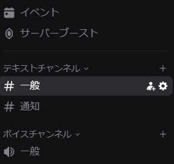
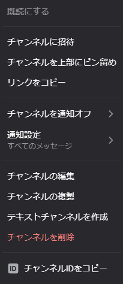
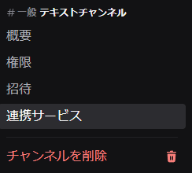
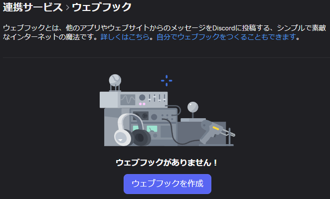
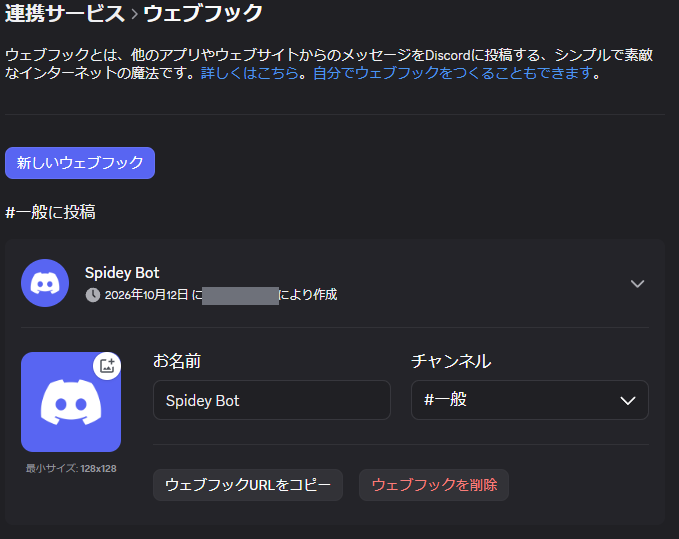

# はじめに

Poke-Controller Modified Extension は、PCからマイコンなどを通してゲーム機のコントローラー入力を送り、操作を自動化するためのツールです。

このマニュアルは、Web ブラウザで表示する画面(Web 版)の使い方です。これまでのウィンドウの画面(tkinter 版)のマニュアルは、tkinter 版の メニュー > ヘルプ > Instruction Manual で開きます。

## できること
- キャプチャーボードの映像を見ながら、キーボード・マウス・PCに接続したコントローラーでゲーム機を操作する
- Python で書いた自動化スクリプト(コマンド)を実行する
- 映像の画像認識を使ったスクリプトを実行する
- 手動操作を記録して、スクリプトとして出力する

## Web 版と tkinter 版の関係
- どちらも同じ機能(カメラ・シリアル・コマンドの実行)を使います。起動するときに、どちらの画面で使うかを選びます。
- プロファイル(設定一式)は共通です。片方で変えた設定は、もう片方を次に起動したときに反映されます。
- 画面の配置(パネルの位置、テーマ、境目の線の位置など)は、Web 版ではブラウザに保存します。tkinter 版の配置とは別で、互いに影響しません。
- スクリプト(コマンド)は、どちらの画面でも同じものを使えます。ただし、スクリプトが tkinter を直接使って独自のウィンドウを開く場合は、Web 版では動きません。

## このマニュアルの見方
- 左の一覧から項目を選ぶと、右に説明が表示されます。
- このマニュアルは、画面右上の ヘルプ > Instruction Manual で開きます。
- 「スクリプト」で始まる項目と「Mcu コマンド」は、tkinter 版のマニュアルと同じ内容です。

# 起動と終了

## 準備
- Web 版は、追加のパッケージ(fastapi、uvicorn、websockets)を使います。uv の環境(PokeConExtension.bat で用意される .venv)には、初めから入っています。PokeConExtension.bat --ui web で起動できます。
- 以前からの環境(PC の Python と pip)で使うときだけ、ツールのフォルダ(SerialController の1つ上)で次を実行します。
```
pip install -r requirements-web.txt
```

## 起動
- SerialController フォルダで次を実行します。
```
python Window.py --ui web
```
- 起動すると、既定のブラウザで画面が開きます。開かない場合は、コンソールに表示されるアドレス(http://127.0.0.1:8765/ など)をブラウザで開きます。
- 付けられるオプションは次のとおりです。
```
python Window.py --ui web --profile 名前
python Window.py --ui web --auto
python Window.py --ui web --port 8800
python Window.py --ui web --no-browser
```
- --profile: 使うプロファイルを指定します。付けない場合は default を使います(tkinter 版と違い、選ぶ画面は出ません)。
- --auto: 起動されていないプロファイルを、優先度の順に自動で選びます。
- --port: 使うポート番号を指定します。付けない場合は 8765 から順に、空いている番号を使います。
- --no-browser: ブラウザを自動で開きません。
- --ui を付けない場合(または --ui tk)は、これまでのウィンドウの画面で起動します。

## 複数のプロファイルで同時に使う
- プロファイルごとに、コンソールを分けて起動します。ポート番号は、1つ目が 8765、2つ目が 8766 のように、空いている番号が順に使われます。開くアドレスは、それぞれのコンソールに表示されます。
- カメラとシリアルポートは、プロファイルごとに別のものを設定してください(同じものは同時に使えません)。
- 画面の配置は、ポート番号ごとにブラウザに保存されます。

## 接続できる範囲
- 画面を開けるのは、このツールを動かしている PC のブラウザだけです。ほかの PC やスマートフォンからは開けません。
- 同じ PC で複数のタブやブラウザから開いた場合、操作できるのは最初に開いた1つだけです。ほかは「閲覧のみ」と表示され、見ることだけができます。操作していた画面を閉じると、次の画面が操作できるようになります。

## 終了
- 画面右上の「終了」を押し、確認で OK を選びます。設定がプロファイルに保存され、ツールが終了します。
- コンソールで Ctrl+C を押しても終了できます。
- ブラウザのタブを閉じただけでは終了しません。実行中のコマンドも止まりません。もう一度アドレスを開くと、続きの出力が表示されます。

# 画面の構成

## 見出し(いちばん上)
- プロファイルの名前、シリアルの接続の状態、カメラの状態が表示されます。
- 設定: カメラ・シリアルなどの設定を、画面の右側に開きます。
- 表示: テーマ、プレビューの大きさ、パネルの位置などを切り替えます。
- ヘルプ: このマニュアル、機能紹介、更新履歴などを開きます。
- 終了: ツールを終了します。

## 左の列
- プレビュー: キャプチャーボードの映像を表示します。
- Start / Pause / Reload: コマンドの実行、一時停止、一覧の読み込み直しです。
- Capture: カメラの画像を Captures フォルダに保存します。
- Open: Captures フォルダを開きます。
- LINE / Discord: 今の画像を送ります。
- 手動操作: キーボード、コントローラー、マウスでのスティック操作、Record(操作の記録)、すべての入力を離す です。「すべての入力を離す」は、押したまま・倒したままになっている入力を、すべて離します(実行中のコマンドは、止めません。コマンドの実行中に押すと、コマンドの動きに影響することがあるので、行ってよいかを確かめます)。
- Software-Controller: 画面上のコントローラーです。

## 右の列
- コマンドの一覧: Python / Mcu / History / Shortcut のタブがあります。
- Output#1 / Output#2: スクリプトやツールからの出力が表示されます。Page 1~3 を切り替えられます。

## 大きさと配置を変える
- 左の列と右の列の間の線をドラッグすると、列の幅が変わります。プレビューは、列の幅いっぱいに表示されます。ダブルクリックで元に戻ります。
- Output#1 と Output#2 の間の線をドラッグすると、Output#1 の高さが変わります。ダブルクリックで元に戻ります。
- Serial: Page 3 の後ろのタブです。機器へ送ったデータを(Show Serial のチェックに関係なく、いつも) [時刻][Data の Format の名前] 値 の形で表示します。
- Log: Serial の後ろのタブです。コンソール(黒い画面)に出ているログと同じ内容を表示します。DEBUG は薄い色、WARNING は黄〜橙、ERROR は赤で表示します。Level で、表示するレベルを絞り込めます(選んだレベルより低い行を隠すだけで、消しません。選んだレベルは、ブラウザに保存します)。
- Note: Log の後ろのタブです。自由に書き込めるメモです。書いた内容は、プロファイルごとに、自動で保存します(書き換えてから約 1 秒後。これまでのウィンドウの画面の Note タブと、同じ内容です)。書き込めるのは、操作できるブラウザだけです(閲覧のみのブラウザには、保存した内容が表示されます)。入力している間は、キーボードでの手動操作を受け付けません。
- Serial と Log と Note のタブは、このブラウザだけの表示の切り替えです(コマンドの出力先のページは、変わりません)。右上の Clear は、操作できるブラウザだけが押せます(すべてのブラウザの表示が消えます)。
- 文字の検索: 出力画面(Page 1~3、Serial、Log、Note)をクリックしてから Ctrl+F を押すか、タブの右端の 🔍 を押すと、検索の欄が出ます。入力した文字を含む所に色が付き、いちばん新しい(下の)一致が選ばれます。Enter か ▲ で前(上)へ、Shift+Enter か ▼ で次(下)へ動きます。Esc か × で閉じます。大文字と小文字は、初めは区別しません。検索の欄の「Aa」を押すと、区別する / しないを切り替えられます。対象は、表示しているタブの出力画面です(Page は Output#1 と #2 の両方)。
- 表示 > プレビューの大きさ で、決まった幅(480~1920)を選べます。
- 表示 > プレビューの画質 で、ブラウザへ送る映像の大きさを選べます。大きいほどくっきりしますが、PC の負荷が増えます。
- 表示 > 右側のパネルの位置 で、右の列を下に置けます。下に置いたときは、プレビューと操作の部品の間の線でプレビューの幅を、コマンドの一覧と Output の間の線で左右の幅を変えられます(プレビューの横の線は、横に広い画面でだけ表示されます)。
- 表示 > コマンドの一覧と Software-Controller の位置を入れ替える で、2つの場所を入れ替えられます。
- 表示 > 表示する部品 で、コマンドの一覧・Output・Software-Controller・手動操作を、それぞれ表示しないようにできます。
- 表示 > ミニ画面 で、プレビューと Start だけの画面になります。
- 表示 > テーマ で、ライトとダークを切り替えます。自動にすると、OS の設定に合わせます。
- 表示 > 画面のリセット で、配置を初めの状態に戻します。
- これらの配置は、ブラウザに保存されます(プロファイルごとではありません)。

# ハードウェアの設定

ゲーム機に入力を送る機器(マイコン)は、使う前に、機器の側の設定が必要です。手順は、機器ごとに、次のページを参照してください(リンクをクリックすると、ブラウザで開きます)。
- Arduino Leonardo: https://pokecontroller.info/SetLeonardo
- CH552 Serial: https://blog.bzl-web.com/entry/2022/11/24/001148

機器の設定が済んだら、次の「最初の設定」で、このツールの側の設定(ポートと Data Format)を行います。

# 最初の設定

画面右上の「設定」を押すと、設定が画面の右側に開きます。開いたまま、プレビューを見たり操作したりできます。変更はその場で反映され、プロファイルに保存されます。

## Status
- 設定のいちばん上にあります。今つながっている機器と、実行中のコマンドを、まとめて確かめられます。表示するだけで、設定は変えません。
- Camera Device: 開いているカメラの名前と、Capture Size。映像が届いていないときは「(開いていません)」。
- Audio Device (Input) / (Output): 取り込んでいるデバイスと、再生しているデバイス。使っていないときは「(使用していません)」。
- Serial Device: 接続している機器の名前(COM ポートの番号を含む)と、Baud Rate。接続していないときは「(接続していません)」。
- 実行中のコマンド: コマンドの名前。実行していないときは「(なし)」。
- 開始時間: 実行中のコマンドを開始した時刻。実行していないときは「(なし)」。

## Camera
- Device: 使うカメラ(キャプチャーボード)を選びます。選ぶと、その場でカメラを開き直します。
- Scan Device: カメラ・シリアルポート・音声デバイスの一覧を取得し直します。機器をつなぎ直したときに押します。
- Reload Camera: カメラを開き直します。
- Capture Size: 取り込む画像の大きさです。変えると画像認識の結果や座標に影響するので、確認が出ます。
- FPS: 取り込みのフレームレートです。
- MJPG: 圧縮形式で取り込みます。フレームレートが上がらない機器で使います。画像がわずかに変わるので、確認が出ます。
- Windows: ほかのアプリケーションのウィンドウを、Device の候補に出します(Windows のみ)。
- Realtime: チェックを外すと、プレビューの表示を止めます。
- Gain / Gamma: プレビューの明るさです。表示だけを変え、画像認識や保存する画像には影響しません。

## Serial
- Device: 使うシリアルポートを選びます。
- Scan Device: シリアルポートの一覧を取得し直します。
- Baud Rate / Format: 通信の速さと、送るデータの形式です。Format を変えると、その形式に合った速さで接続し直します。
- Reload Port / Disconnect Port: 接続し直す / 切断する、です。
- Show Serial: 送ったデータを Output にも表示します(Serial タブには、チェックに関係なく、いつも表示します)。

## Audio
- Use Audio にチェックを入れると、Input で選んだ機器の音声を取り込みます。
- Playback にチェックを入れると、Output で選んだ機器から再生します(音声は、ブラウザではなく PC 側で鳴ります)。
- Level に、取り込んでいる音量が表示されます。

# コマンドを実行する

## 選んで実行する
- Python または Mcu のタブで、コマンドを選んで Start を押します。行をダブルクリックしても実行できます。
- 実行中は Start が Stop になります。Pause で一時停止、Restart で再開します(Mcu コマンドは一時停止できません)。
- スクリプトのファイルを追加・変更したときは、Reload を押します。

## 探す
- 「名前で検索」に文字を入れると、名前にその文字を含むコマンドだけが表示されます。
- Tags ▾ で、タグを選んで絞り込めます。複数選ぶと、いずれかを持つコマンドが表示されます。
- これまでのウィンドウの画面(コマンド > 実行リスト)で作った実行リストは、Python の一覧の最後に「名前 (実行リスト)」として並び、Web ブラウザ版からも開始できます(実行リストの編集と、開始・停止の予約は、これまでのウィンドウの画面で行います)。
- 並び順は、既定の順・名前・更新日時・使用頻度から選べます。使用頻度は、そのコマンドを開始した回数です(プロファイルに関係なく、まとめて数えます)。

## History と Shortcut
- History: 実行したコマンドの履歴です。選んで Start で、もう一度実行できます。Last Run のボタンで、新しい順と古い順を切り替えます。
- Shortcut: よく使うコマンドを 12 個まで登録できます。コマンドを選び、一覧の下で番号を選んで「選択中のコマンドを設定」を押します。

## 右クリックのメニュー
- コマンドの行を右クリックすると、ファイルを開く(Open file / Open with... / Open folder)、パスのコピー、Shortcut への設定ができます。
- History では、履歴の削除(Delete / Delete (ALL))もできます。

## キー操作
- F5: コマンドの一覧を読み込み直します(Reload と同じ)。
- F6: 選んでいるコマンドを実行します。
- Esc: 実行中のコマンドを止めます。
- ブラウザのページの再読み込みは、Ctrl+R で行えます。

## 実行中のコマンドを自動で止める場合
- PC がスリープから戻ったとき(20 秒より長く止まっていたとき)と、機器への送信に 5 回続けて失敗したときは、実行中のコマンドを止めて、Output にその旨を表示します(スクリプトとゲームの画面がずれたまま、進み続けないようにするためです)。

## 出力
- コマンドの出力は、開始したときに表示していたページ(Page 1~3)に出ます。
- 画像を保存したときに出るパスはリンクになっていて、クリックするとブラウザで画像が開きます。右クリックすると、PC のアプリで開く・フォルダを開く・パスのコピーができます。
- スクリプトがダイアログ(入力の画面)を開いた場合は、ブラウザに表示されます。

# 手動で操作する

## Software-Controller(画面上のコントローラー)
- 左クリック: 押している間だけ入力します。スティックはドラッグします。
- 右クリック(スティックは右ドラッグ): 押しっぱなしで固定します。もう一度押すと解除します。
- HOLD をオンにして左クリック、または Shift を押しながら離しても、固定できます。黄色の HOLD を押すと、固定をすべて解除します。
- Layout で、Switch (Joy-Con) / Switch (Pro Controller) / 3DS / DS / GameCube を選べます。
- 表示 > Controller Simulator で、大きいコントローラーを画面の右下に開けます。

## キーボード
- 「キーボード」にチェックを入れると、キーボードで操作できます。キーは、ツールを動かしている PC 側で読み取ります。
- Alt キーを押している間のキーは、ゲーム機には送りません(ブラウザのメニューの操作などと重ならないようにするためです)。
- 受け付けるのは、操作できる画面が前面にあり、入力欄や一覧を選んでいない間だけです。ボタンやチェックを押した後は、自動で選択を外します。
- キーとボタンの対応は、設定 > Key Config で、ゲーム機ごとに設定します。欄を選んで、割り当てるキーを押し、「保存」を押します。
- 矢印キーは左スティックです。

## マウスでスティックを操作する
- 「左ドラッグ: Lスティック」「右ドラッグ: Rスティック」にチェックを入れると、プレビュー上のドラッグでスティックを操作できます。

## PCに接続したコントローラー
- 設定 > Controller の Device で、使うコントローラーを選びます。一覧に出ない場合は「接続中のコントローラーを調べる」を押します。
- 「コントローラー」にチェックを入れると、操作を始めます。使っている間は、コマンドを開始すると自動で止まります。
- ボタンの割り当ては、設定 > Controller の「ボタンの割り当てを設定」で作れます。画面の案内に沿って、入力を1つずつ押します。

## タッチスクリーン(Qingpi / 3DS)
- Format が Qingpi または 3DS Controller のとき、「右ドラッグ」の表示が「タッチスクリーン」になります。チェックを入れ、プレビュー上のタッチスクリーンの範囲を右クリック(右ドラッグ)すると、タッチを送ります。
- 範囲は、設定 > Touch Screen の数値、または「プレビューをドラッグして指定」で設定します。座標は、取り込みサイズ(Capture Size)の上の値です。

## 操作を記録する(Record)
- Record を押すと、手動操作の記録を始めます。記録中はボタンが赤くなります。
- もう一度押すと記録を終え、自動化スクリプトを出力します。出力先は Output に表示されます。
- コマンドの実行中は記録できず、記録中はコマンドを開始できません。

# Capture・Mask・通知

## Capture(画像の保存)
- Capture: カメラの画像を Captures フォルダに保存します。
- プレビュー上で Ctrl + Shift + 左ドラッグ: 選んだ範囲を Captures フォルダに保存します。
- プレビュー上で Ctrl + Alt + 左ドラッグ: 選んだ範囲を、名前を付けて Template フォルダに保存します(テンプレート画像を作るときに使います)。名前に「/」を入れると、フォルダを分けられます。
- プレビュー上で Ctrl + 左クリック: その位置の座標(取り込みサイズ上の値)と色を、Output に表示します。

## Mask(目隠し)
- SNSにおける投稿や配信を想定した、見せたくない情報を隠すための機能です。
- 設定 > Mask の「追加(プレビューをドラッグ)」を押し、プレビュー上をドラッグすると、その範囲を塗りつぶして隠せます。形は長方形と楕円から選べます。
- 一覧で、座標・色・形・有効を変えられます。
- 「表示する」のチェックを外すと、目隠しを表示しません。
- 「保存する画像にも適用」にチェックを入れると、Capture などで保存する画像にも目隠しを描きます。
- 目隠しは、プレビューの表示にだけ掛かります。コマンドの画像認識には影響しません。
- 「書き出す」「読み込む」で、目隠しの一覧を Masks フォルダのファイルに保存・読み込みできます。

## 通知
- 設定 > Notification で、コマンドの開始時・終了時に通知するかを、Windows / LINE / Discord それぞれで選びます。
- Discord の開始時・終了時の通知には、文字に、キャプチャ画面の今の画像が付きます(tkinter 版の「ウィンドウ全体」は、Web 版では選べません。tkinter 版で選んでいても、Web 版では、キャプチャ画面の画像を送ります)。
- 「Windows 通知のテスト」で、通知を1つ出して確かめられます。
- 設定 > Discord で、通知先(Webhook URL)を名前を付けて登録します。既定の通知先 DISCORD_WEBHOOK は、最初に設定します。「接続を確認」で、設定を確かめられます。手順は、「Discord 通知の設定」を見てください。
- 設定 > LINE で、トークンを保存します。保存済みのトークンは画面に表示されません。

# Discord 通知の設定

コマンドの開始や終了、スクリプトからのメッセージや画像を、Discord のチャンネルに送れます。Discord の側で「ウェブフック(Webhook)」を作り、その URL を、このツールに登録します。

## 1. Discord で、ウェブフックを作る
- 通知を送りたいサーバーで、「ウェブフックの管理」の権限が必要です(自分で作ったサーバーなら、行えます)。
- 通知を送りたいテキストチャンネルにマウスを重ねて、歯車のボタン(チャンネルの編集)を押します。

- チャンネルを右クリックして、「チャンネルの編集」を選んでも開けます。

- 左の一覧から「連携サービス」を選びます。

- 「ウェブフックを作成」を押します。

- ウェブフックが 1 つ作られます。「お名前」(Discord に表示される送信者の名前)と「チャンネル」(送り先)を確かめて、「ウェブフックURLをコピー」を押します。

- コピーした URL は、パスワードと同じ、秘密の値です。URL を知っている人は、だれでも、そのチャンネルに投稿できます。人に見せたり、公開する場所に貼ったりしないでください。漏れた場合は、「ウェブフックを削除」で消して、作り直します。

## 2. このツールに、URL を登録する
- 画面右上の 設定 を開き、「Discord (通知先)」の欄を表示します。
- Name は DISCORD_WEBHOOK のままにします(既定の通知先の名前です)。
- Webhook URL に、コピーした URL を貼り付けて、「保存」を押します(入力した URL は、伏せて表示されます。「URL を表示」にチェックを入れると、見られます)。
- Username と Avatar URL は、空のままで構いません。Username を入れると、Discord に表示される送信者の名前を、このツールの側で変えられます。
- 登録した内容は、プロファイルごとに保存されます(tkinter 版と共通です)。

## 3. 送れるかを確かめる
- 「Discord (通知先)」の欄の「接続を確認」を押すと、結果が表示されます。
- Main Panel の Discord ボタンを押すと、今の画像が Discord に送られます。

## 4. 通知を使う
- コマンドの開始時・終了時に通知する: 設定 の「Notification」の欄で、Discord の Start / End にチェックを入れます。
- スクリプトから送る: discord_text(文字)と discord_image(文字と、今の画像)を使います(「スクリプト: 通知と通信」を参照)。
- 通知先を増やす: 「Discord (通知先)」の欄で、別の Name を付けて保存すると、スクリプトから送り先を選べます。

# ツール

見出しの「ツール」から開きます。使えるのは、操作できる画面(「閲覧のみ」でない画面)だけです。

## タグを編集
- コマンドのファイルを開かずに、タグ(クラスの TAGS)を足したり外したりできます。
- 左で種類(Python / Mcu)とコマンドを選びます。右の「付いているタグ」を押すと外れ、「タグを足す」に入力して 追加 を押す(または Enter)と足せます。「ほかのコマンドで使っているタグ」を押しても足せます。
- 保存 を押すと、変更したコマンドのファイルを、まとめて書き換えます(TAGS の行だけを書き換えます)。元に戻す は、保存していない変更を取り消します。
- ⚠ の付いたコマンドは、編集できません(TAGS が、文字だけを並べた一覧でない場合など。理由は、選ぶと右に表示します)。
- 左下の「タグの一括変更」で、表示している種類のすべてのコマンドのタグを、まとめて変えられます。タグを選び、新しい名前を入力して 名前を変更 を押すと、そのタグの名前が変わります(新しい名前のタグをすでに持っているコマンドでは、1 つにまとめます)。削除 を押すと、そのタグをすべてのコマンドから外します。どちらも、保存 を押すまではファイルに書き込みません。
- フォルダーの名前から付くタグ(@フォルダー名)は、編集できません。「@」で始まるタグは、足せません。
- この画面を開いた後に、エディターなどで書き換えられたファイルは、上書きしません(今の内容を読み直します)。

## 新しい自動化スクリプトをつくる
- 新しいスクリプトのひな形を作ります。入力する項目は、Instruction Manual の「スクリプトの作り方」の「ひな形から作る」と同じです。
- スクリプト格納場所を空にすると、Commands/PythonCommands の直下に作ります。
- 作成 を押すと、ファイルを作り、コマンドの一覧で選んだ状態にして、ツールを動かしている PC のエディタで開きます。
- 作れないとき(同じ名前のファイルがある、など)は、理由を赤い文字で表示します。

## Keyboard
- Switch のキーボード画面(文字を入力する画面)に、画面上のキーボードから文字を打ちます。画面の左下に開きます。
- 使えるのは、シリアルポートに接続していて、Format が Default または NX のときです。使えないときは、下の行に理由を表示します。
- キーボード: 左の あ / ア / a / A / 1#※ でページを切り替えます。小字゛゜ は、濁点・半濁点・小さい字のページへの切り替えです。右は、1 文字消す・空白・改行・OK(コントローラーの + ボタン)です。
- テキスト入力: 文字を入力して Enter(または 送信)を押すと、まとめて送ります。送れるのは、半角の英数字・記号と、かな・カナです(漢字は送れません)。
- かな・カナは、ローマ字に直して送ります。「Switch 側の入力モードを、自動で切り替える」にチェックを入れておくと、ページや文字に合わせて、Switch 側のかな / カナ / 英字を切り替えます。
- Switch 側でモードを変えてずれたときは、地球のマークを押すと、今のページに合わせ直します。

## モニター
- 同じ PC で、--monitor を付けて起動したウィンドウ(tkinter 版・Web 版)の、実行中のコマンド・Output・カメラの映像を、最大 12 個まで並べて表示します。
- 枠ごとに、左上の欄でプロファイルを選びます。右隣の欄で、表示する出力画面(Stdout / #1 / #2)を選びます。
- ▶ は、そのウィンドウの一覧で選んでいるコマンドを開始します(一時停止中は、再開します)。⏸ は一時停止、■ は停止です。
- All Start / All Stop: つながっているすべてのウィンドウで、コマンドを開始(一時停止中は再開)/ 停止します。実行の前に、対象の一覧を表示して確認します。
- 映像をダブルクリックすると、その 1 つを大きく表示します。もう一度ダブルクリックすると、元に戻ります。
- 数(1〜12)・映像 (fps)(毎秒 2〜30)・枠ごとの割り当ては、ブラウザに保存します。
- 前面に表示: tkinter 版のウィンドウを、最前面に表示します。ブラウザが前面にあるため、Windows の決まりで、前に出ないことがあります。Web 版の画面は、前面に表示できません。
- 枠の配色は、この画面のテーマのままです(相手のウィンドウのテーマには、合わせません)。

## 補助ツール(Monitor.py)から、この画面を見る
- 起動するときに --monitor を付けると、補助ツール(python Monitor.py)や、ほかの Web 版のモニターから、このプロファイルの状態・Output・映像を見て、開始・一時停止・停止ができます。
```
python Window.py --ui web --profile 名前 --monitor
```
- ▶ で始まるのは、操作できる画面が、一覧(Python / Mcu / History)で選んでいるコマンドです。画面を閉じた後は、最後に選んでいたコマンドです。

# 設定とヘルプ

## そのほかの設定
- Controller Color: Software-Controller の本体の色を、コントローラーの種類ごとに変えられます。Preset から選ぶこともできます。「今の色を書き出す」で、自分の色を Preset に追加できます。
- Others > Value: 画像認識の類似度を Output に表示します。
- Others > Guide: 画像認識で見つけた位置を、プレビューに枠で表示します。
- Others > Stdout: print の出力先を、Output#1 と Output#2 から選びます。
- Others > ダイアログのボタン: スクリプトが開くダイアログの、OK / Cancel の位置です。
- Profile: 今のプロファイルと一覧を表示します。名前を入れて「追加」を押すと、プロファイルと、そのプロファイルで起動する bat ファイルを作ります。作ったプロファイルを Web 版で使うには、--profile を付けて起動し直します。

## ヘルプ
- Instruction Manual: このマニュアルです。
- 機能紹介: Web 版の機能を、ページごとに紹介します。起動時にも表示されます。「今後は表示しない」にチェックを入れて OK を押すと、起動時には表示されなくなります。
- 更新履歴表示 / LICENSE: それぞれの内容を表示します。
- 環境の診断: このアプリを動かすのに必要なものを調べて、結果を表示します(アプリ・OS・Python・ライブラリのバージョン、必要なライブラリが入っているか、OneDrive の中で動かしていないか、フォルダーに書き込めるか、ディスクの空き、シリアル、カメラ、コマンドの数)。調べるだけで、設定は変えません。「コピー」で全体をコピーできます。「マスクしてコピー」は、フォルダーの場所(アプリのフォルダーより上の階層と、ユーザーのフォルダー)を *** にしてコピーします。
- 質問テンプレート: 問い合わせ用の文章を作ります。
- アップデート確認: 新しい版(GitHub の Release)が公開されているかを確かめます。

# Web 版で使えないもの

次の機能は、Web 版にはありません。必要な場合は、tkinter 版(--ui を付けずに起動)を使ってください。
- アプリケーションのウィンドウ全体の保存(Screenshot)。ブラウザの画面の保存は、ブラウザや OS の機能を使ってください。
- 起動時にプロファイルを選ぶ画面(Web 版は --profile で指定します)
- ブラウザでの音声の再生(音声は PC 側で再生します)
- ほかの PC やスマートフォンからの操作

スクリプトについての注意は、次のとおりです。
- スクリプトが tkinter を直接使って独自のウィンドウを開く場合は、Web 版では動きません。
- ダイアログ(dialogue、dialogue6widget など)、print_t1 / print_t2 などの出力、画像認識の位置の表示は、Web 版でも使えます。

# 困ったとき

## 画面が開かない・何も表示されない
- コンソールに表示されたアドレスを、ブラウザで開いているかを確かめます。ポート番号は、起動するたびに変わることがあります。
- 「サーバーに接続していません」と出る場合は、ツールが終了しています。起動し直してから、ページを再読み込みします。
- 表示がおかしい場合は、ページを再読み込み(Ctrl+R)します。配置を戻すには、表示 > 画面のリセット を選びます。

## 「閲覧のみ」と表示される
- 別のタブやブラウザで、先に画面が開かれています。操作できるのは最初に開いた1つだけです。先に開いた方を閉じると、操作できるようになります。

## 映像が出ない
- 見出しに「Camera: 映像なし」と出る場合は、設定 > Camera で Device を選び直すか、Scan Device を押してから選びます。
- ほかのアプリケーション(tkinter 版や、別のプロファイルの Web 版を含む)が同じカメラを使っていると、映像を取り込めません。
- 設定 > Camera の Realtime にチェックが入っているかを確かめます。

## 操作が届かない
- 見出しに「Serial: 未接続」と出る場合は、設定 > Serial で Device を選び、Reload Port を押します。
- キーボードで操作できない場合は、「キーボード」にチェックが入っているか、入力欄や一覧を選んだままになっていないか(プレビューの何もないところをクリックすると外れます)を確かめます。

## 起動できない
- 「No module named fastapi」などと出る場合は、追加のパッケージが入っていません。「起動と終了」の準備を行ってください。
- --port で指定した番号がほかで使われている場合は、起動できません。別の番号を指定するか、--port を付けずに起動します。
